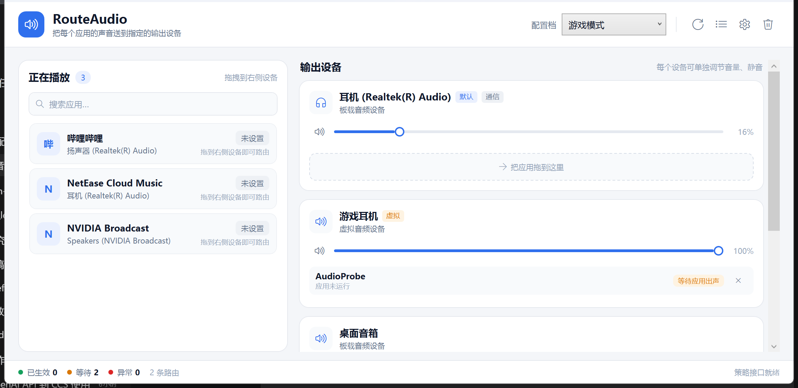

# RouteAudio · 声路由

[](https://github.com/YumHoward/RouteAudio/actions/workflows/ci.yml)
[](LICENSE)


> 把**每一个进程**的声音，送到**你想让它去的那个音箱**。

Windows 按进程音频输出分配工具：游戏进耳机、音乐进音箱、会议进通讯耳机、直播混音进采集卡——一次配置，长期生效。



| 项目代号 | routeaudio |
| --- | --- |
| 文档版本 | v1.0（2026-11） |
| 目标平台 | Windows 10 1803+ / Windows 11（x64、ARM64） |
| 技术栈 | .NET 8 + WPF + WASAPI（C# / 手写 COM 互操作） |
| 许可证 | MIT（自有代码） |
| 当前阶段 | v0.3.1 可用版本（策略路由 + 设备音量 + 规则/配置档） |

---

## 1. 一句话说清要解决的问题

Windows 的音频输出是**设备级**的：一个默认播放设备，所有程序都往那儿送。想让「游戏走耳机、音乐走音箱」，系统原生只能做到「在设置里一个个点」，而且：

- 找不到正在运行但没出声的程序，设备换了要重设；
- 无法按「场景」批量切换（游戏模式 / 工作模式 / 直播模式）；
- 无法按规则自动化（某程序一启动就自动路由）；
- 无法对同一程序做音量补偿、双设备同播、混音。

RouteAudio 要做的就是把这件事变成**一次拖拽 + 一套规则**。

## 2. 五分钟看懂技术结论

Windows 上「按进程分配输出」可行，且有三条互不排斥的实现路径。本项目采用 **A 为主、B 兜底、C 可选、D 长期** 的分层策略：

| 路线 | 机制 | 延迟 | 依赖 | 结论 |
| --- | --- | --- | --- | --- |
| **A 系统策略路由** | `IAudioPolicyConfigFactory`（系统内部 API，即 Win10「应用音量和设备首选项」背后的实现） | 0（不经过我们） | 无 | **v1.0 主线**，**已实测通过** |
| **B 进程回环重渲染** | `ActivateAudioInterfaceAsync` + `AUDIOCLIENT_ACTIVATION_TYPE_PROCESS_LOOPBACK` 采集单进程音频 → WASAPI 渲染到目标设备 | 25–50 ms | Win10 2004+ | **已实测：只能做镜像/录制**（静音原声会把采集也静音） |
| **C 虚拟声卡** | 策略把进程推进虚拟端点，再对虚拟端点做设备回环采集并转发 | 30–80 ms | 第三方驱动 | **已实测可用**，作为「搬移」的兜底 |
| **D 自有虚拟音频驱动** | AVADriver 类虚拟端点，内核层转发 | <10 ms | EV 签名 + 微软认证 | v2.x 评估，成本高 |

> 最关键的一条判断：**A 路线不需要常驻进程、不需要驱动、不改变音质、不引入延迟**——它只是修改系统里「这个程序默认用哪个端点」的持久化策略，由音频引擎在会话建立时执行。因此产品主体是一个**配置与自动化工具**，而不是一个实时音频处理器。
>
> 2026-11-08 已完成首轮 PoC（[报告](docs/05-PoC结果报告.md)）：**A 通过**（附关键坑：deviceId 必须传**设备接口路径**，不是端点 ID）；**B 的「静音后仍可采集」假设被证伪**（静音即静音，因此 B 只能做镜像/录制）；**C 虚拟声卡桥接验证可用**，作为「搬移」的兜底。

## 3. 文档地图

| 文档 | 内容 | 读者 |
| --- | --- | --- |
| [README.md](README.md) | 项目概览、技术结论、索引 | 所有人 |
| [01-需求规格说明书](docs/01-需求规格说明书.md) | 背景、用户场景、60+ 条功能需求（FR）、非功能需求（NFR）、验收标准、版本路线 | 产品 / 开发 / 测试 |
| [02-技术方案与架构设计](docs/02-技术方案与架构设计.md) | Windows 音频架构、四条路线对比、总体架构、核心模块、数据模型、时序、UI 设计、性能预算、ADR | 架构 / 开发 |
| [03-项目结构与实施计划](docs/03-项目结构与实施计划.md) | 仓库目录树、分层规则、接口骨架、构建与 CI/CD、测试计划、里程碑与排期、风险登记册、合规清单 | 开发 / 项目管理 |
| [04-附录](docs/04-附录-PoC验证清单与技术参考.md) | PoC 验证清单（P1–P10）、API 速查、参考资料、术语表、待定问题 | 全员 |
| [05-PoC 结果报告](docs/05-PoC结果报告.md) | 首轮实测结果（P1 通过 / P2 不通过 / C1 通过）、架构调整、复现步骤 | 全员 |
| [06-实现进度](docs/06-实现进度.md) | 实现清单、端到端验证记录、构建运行方式、下一步 | 全员 |
| [CONTRIBUTING.md](CONTRIBUTING.md) | 环境要求、构建测试、代码约定、PR 流程 | 贡献者 |
| [CHANGELOG.md](CHANGELOG.md) | 版本变更记录 | 所有人 |
| [SECURITY.md](SECURITY.md) | 漏洞报告方式与安全边界 | 安全研究者 |
| [THIRD-PARTY-NOTICES.md](THIRD-PARTY-NOTICES.md) | 第三方组件与许可 | 合规 / 分发 |

## 4. 仓库结构

```
RouteAudio/
├─ docs/                        # 设计文档（01–06）
├─ src/
│  ├─ RouteAudio.sln
│  ├─ RouteAudio.App/           # WPF 界面 + 托盘（已实现）
│  ├─ RouteAudio.Core/          # 领域层：路由对账、规则、配置（已实现）
│  ├─ RouteAudio.Audio/         # WASAPI/策略/回环实现（已实现）
│  ├─ RouteAudio.Interop/       # 唯一允许 P/Invoke 与 COM 定义的项目（已实现）
│  ├─ RouteAudio.Engine/        # v2：独立引擎宿主（规划）
│  ├─ RouteAudio.Cli/           # 命令行（规划）
│  └─ RouteAudio.Contracts/     # IPC 契约（规划）
├─ tests/
│  └─ RouteAudio.Core.Tests/    # 26 个单元测试（已通过）
├─ tools/
│  └─ AudioProbe/               # PoC / 排障工具：设备、会话、策略、回环
├─ installer/                   # WiX 安装包（规划）
└─ build/                       # 构建脚本（规划）
```

## 5. 当前状态（v0.3.1 可运行版本）

```powershell
dotnet build src/RouteAudio.sln -c Debug
src\RouteAudio.App\bin\x64\Debug\net8.0-windows\RouteAudio.exe
dotnet test tests\RouteAudio.Core.Tests\RouteAudio.Core.Tests.csproj   # 28 passed
```

**已实现**：设备/会话枚举、策略路由（含回读校验与降级）、拖拽路由 UI、应用身份识别、规则求值 + 规则/配置档编辑 UI、设备别名、**每个设备独立的音量/静音控制**、**虚拟设备隐藏开关**、配置档增删改复制与切换、配置持久化与备份、设备热插拔事件、Toast 通知、流式管线（采集→渲染，镜像/桥接基础）、托盘、设置、开机自启、状态与原因码、日志。

**端到端已验证**：写入配置 → 应用对账 → 策略下发 → 应用重新建会话后音频落到目标设备 → UI 状态从「已设置（下次生效）」翻转为「已生效」。

**下一步**：镜像接产品（「同播到…」）、兼容模式（C 路线）、代码签名与自动更新、兼容性矩阵。详见 [06-实现进度](docs/06-实现进度.md)。

## 6. 核心特性（v1.0 目标）

- **拖拽路由**：把正在播放的应用拖到任意输出设备上，立即生效并记住。
- **进程识别**：按可执行文件路径、发布者签名、进程树、窗口标题识别应用；重启、换路径后可重新匹配。
- **规则自动化**：`当 程序 X 启动 → 路由到 设备 Y`；支持通配符、优先级、按设备角色（控制台/多媒体/通信）分别设置。
- **配置档**：游戏 / 工作 / 直播 一键切换（托盘、热键、CLI、设备插入事件触发）。
- **设备热插拔**：设备拔出 → 自动回退到默认设备并提示；设备插入 → 自动恢复该端口的路由。
- **音量与增益**：每路独立音量、增益补偿、静音；双设备同播（镜像）。
- **可观测**：每路电平表、路由状态、延迟与丢帧计数、一键导出诊断包。
- **零特权**：普通用户权限运行，不注入、不挂钩、不联网。

## 7. 不做（v1.0 明确范围外）

- macOS / Linux / 手机；网络音频串流；ASIO/超低延迟专业音频；多用户同时路由；DRM 内容解密；绕过反作弊；内核驱动。

## 8. 许可与合规

本项目以 [MIT](LICENSE) 许可发布，可自由使用、修改、分发（保留版权声明）。第三方组件清单见 [THIRD-PARTY-NOTICES.md](THIRD-PARTY-NOTICES.md)。

- 项目**不打包、不分发**任何第三方音频驱动；VB-CABLE / VoiceMeeter / NVIDIA Broadcast 等虚拟设备由用户自行安装。
- 不修改系统音频驱动、不绕过版权保护（DRM）、不提供反作弊对抗能力。

## 9. 免责声明

本项目使用 Windows **未公开接口**（`Windows.Media.Internal.AudioPolicyConfig`）实现按应用选择输出设备。该接口可能随系统更新失效（表现为「路由不生效」，不会导致系统损坏或提权）；请在升级 Windows 大版本后自行验证。软件按「现状」提供，作者不对因使用本软件造成的设备设置变化、音频异常或数据损失承担责任。

遇到问题请先阅读 [SECURITY.md](SECURITY.md) 与 [CONTRIBUTING.md](CONTRIBUTING.md)，或提交 Issue。

---

**变更记录**

| 版本 | 日期 | 说明 |
| --- | --- | --- |
| v1.0 | 2026-11-08 | 首版：完成需求、架构、项目结构与实施计划 |
| v0.1 实现 | 2026-11-08 | P1/C1 通过、P2 证伪；完成可运行垂直切片（策略路由 + WPF UI + 26 测试） |
| v0.2 | 2026-11-08 | P3 通过；规则/配置档编辑 UI、设备事件、Toast、流式管线（镜像基础） |
| v0.3 | 2026-11-13 | 设备音量/静音控制；主界面重构（卡片式布局、应用合并、虚线拖放区、应用图标） |
