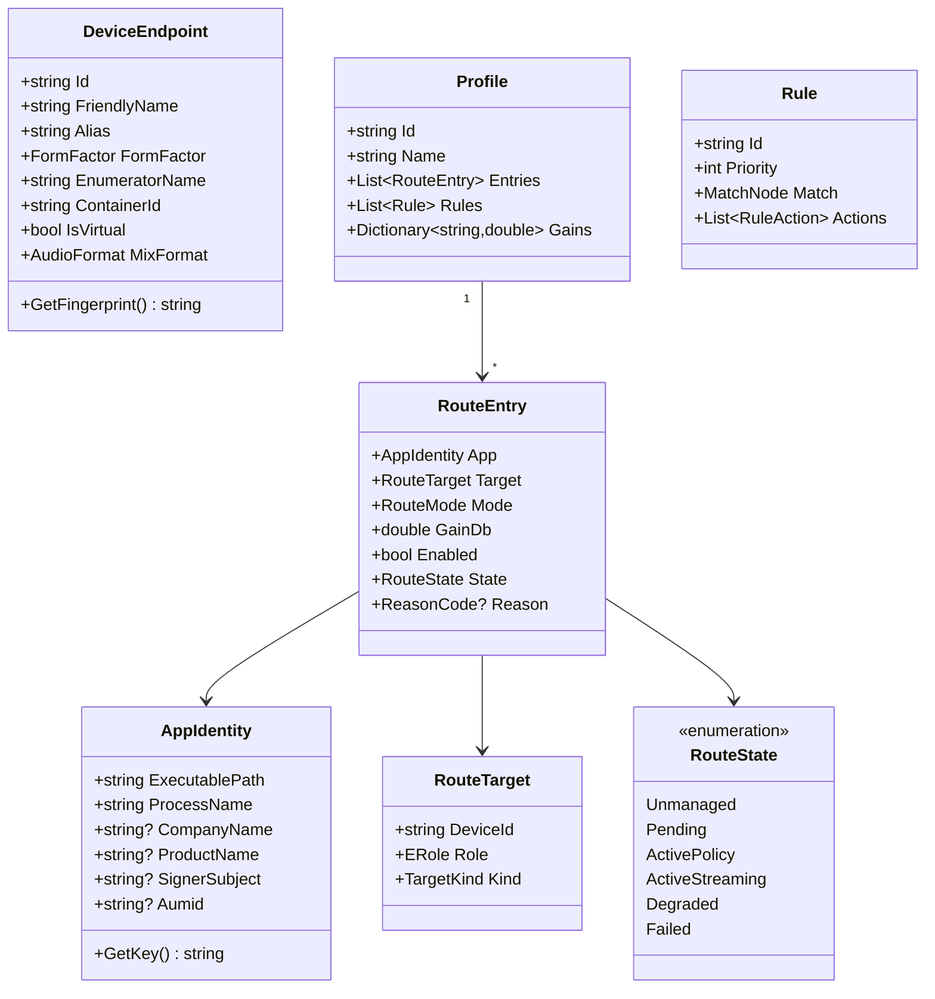
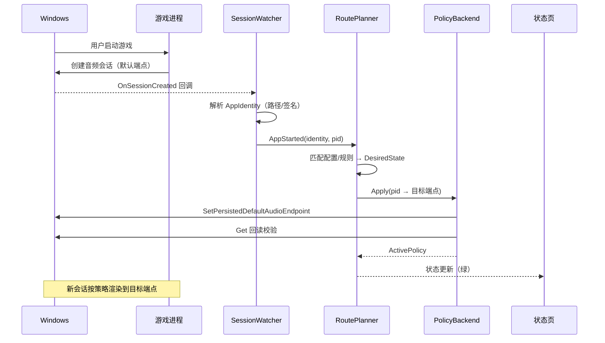
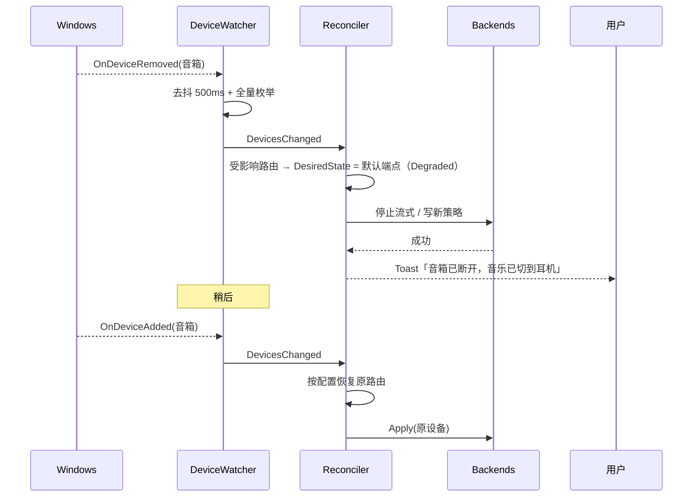
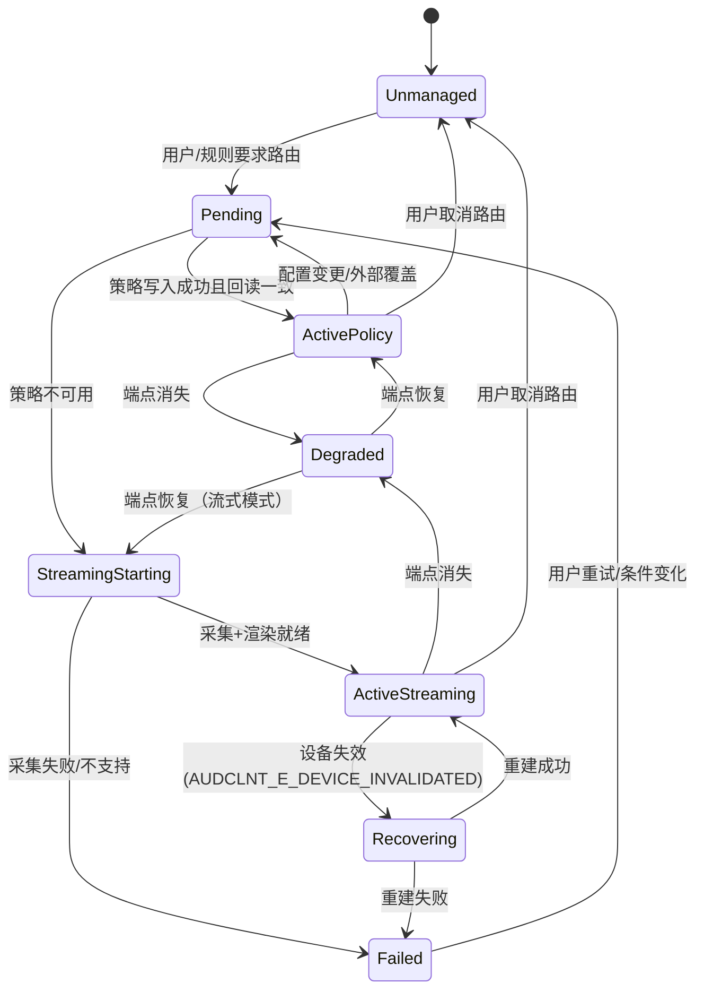

# 02 · 技术方案与架构设计

| 项 | 内容 |
| --- | --- |
| 文档编号 | RA-ARCH-001 |
| 版本 | v1.0 |
| 日期 | 2026-11-08 |
| 关联 | [01 需求](01-需求规格说明书.md) · [03 实施](03-项目结构与实施计划.md) · [04 附录](04-附录-PoC验证清单与技术参考.md) |

---

## 1. 结论先行

1. **能实现，且不需要驱动、不需要管理员权限。** Windows 自 Win10 1803 起自带「按应用指定默认输出端点」的能力，其实现是一个内部 WinRT 类 `Windows.Media.Internal.AudioPolicyConfig`。调用它写一条持久化策略，音频引擎会在**创建音频会话时**把该进程的音频路由到指定端点。零延迟、零音质损失、进程退出后仍然生效。
2. **这条内部 API 是唯一的技术风险点**，因为它不是公开契约。应对方式：把它封装进 `IRoutingBackend` 的独立实现，做**版本探测 + 运行时自检 + 失败降级**，保证 API 挂掉时产品退化为「流式路由」而不是「不能用」。
3. **流式路由（进程回环采集 → 重渲染）是兜底**，适用于策略失效的程序（独占模式、部分 UWP、需要多设备同播、需要通道音量的场景）。它引入 25–50 ms 延迟，并有一个必须先验证的假设：**把原会话静音后，进程回环是否还能采到声音**。若不能，则改用「策略指向虚拟声卡 → 采集虚拟声卡」的组合（C 路线），代价是要求用户安装虚拟声卡。
4. **架构上把「配置与自动化」和「实时音频处理」彻底分开。** 前者是产品价值主体（规则、配置档、自愈、可观测），后者是可选增强。这样即使音频引擎写不出来，产品依然成立。

---

## 2. Windows 音频架构速览

```
┌──────────┐  ┌──────────┐  ┌──────────┐
│ 游戏.exe │  │ 音乐.exe │  │ 会议.exe │        用户态进程
└────┬─────┘  └────┬─────┘  └────┬─────┘
     │ IAudioRenderClient（共享模式）
     ▼             ▼             ▼
┌─────────────────────────────────────────┐
│            音频会话 Session              │  ← 音量/静音/格式/会话事件
├─────────────────────────────────────────┤
│        音频引擎 Audio Engine             │  ← 混音、采样率转换、APO 效果链
│   （每端点一个引擎实例，可被独占）        │
└───────────────┬─────────────────────────┘
                │ 内核流（KS）
                ▼
┌─────────────────────────────────────────┐
│  端点 Endpoint（扬声器/耳机/HDMI/虚拟）   │  ← IMMDevice，ID `{0.0.0.…}.{guid}`
└───────────────┬─────────────────────────┘
                ▼
           音频驱动 / 硬件
```

对实现有意义的五个事实：

1. **默认设备是分角色的**：`eConsole`、`eMultimedia`、`eCommunications` 各有一个默认端点，注册表 `HKCU\...\MMDevices` 与系统策略共同维护。
2. **会话是「进程 × 端点」的容器**：`IAudioSessionManager2` 只能枚举**某个端点**上的会话。想知道「这个应用现在在哪个端点」，必须遍历所有活动渲染端点。
3. **共享模式下引擎负责重采样**：客户端可以声明任意格式并加 `AUDCLNT_STREAMFLAGS_AUTOCONVERTPCM`，由引擎转换到端点的 mix format。这意味着我们**不需要自己写 SRC**（漂移补偿除外）。
4. **独占模式绕开引擎**：应用直接向端点写数据。此时任何基于引擎的干预（策略、APO、回环）都失效。
5. **策略是「会话创建时」执行的**：改了策略，已存在的会话不会立刻搬家（取决于 Windows 版本与实现），新会话一定生效。这是「立即生效」需求的现实边界。

---

## 3. 四条实现路线

### 3.1 路线 A：系统策略路由（推荐主线）

**原理**：系统内部 WinRT 类 `Windows.Media.Internal.AudioPolicyConfig` 暴露三个方法，用于按**进程 ID** 持久化「该进程默认使用哪个渲染端点」：

| 方法 | 作用 |
| --- | --- |
| `GetPersistedDefaultAudioEndpoint(pid, flow, role, out HSTRING deviceId)` | 读当前覆盖；返回的是**设备接口路径** |
| `SetPersistedDefaultAudioEndpoint(pid, flow, role, HSTRING deviceId)` | 写覆盖；`deviceId` 必须是设备接口路径，传空串表示清除（**均已在 Win11 26300 实测**） |
| `ClearAllPersistedApplicationDefaultEndpoints()` | 清空所有应用的覆盖（系统设置里的「重置」用它）——**项目中禁止调用**，它会抹掉用户在其他位置配置的覆盖 |

> ⚠️ **实测踩坑（P1，2026-11）**：`deviceId` 不能直接传 `IMMDevice::GetId()` 的 `{0.0.0.00000000}.{guid}`，否则返回 `E_INVALIDARG (0x80070057)`。正确格式是设备接口路径：
>
> ```
> \\?\SWD#MMDEVAPI#{0.0.0.00000000}.{guid}#{e6327cad-dcec-4949-ae8a-991e976a79d2}
>                                                     └── 渲染接口类 GUID ──┘
> ```
>
> 采集端点用 `#{2eef81be-33fa-4800-9670-1cd474972c3f}`。`Get` 返回的也是这个路径，需要解包后再与端点 ID 比较。`E_INVALIDARG` 同时代表「格式错误」与「进程当前没有音频会话」，必须分开判断。

Windows 设置里的「应用音量和设备首选项」「音量合成器」就是这套 API 的 UI。EarTrumpet、SoundSwitch 等开源项目多年使用，验证了它的可用性与免管理员权限特性。

**取用方式**：该类不是公开 WinRT 类型，没有 `.winmd`，只能：

1. `RoGetActivationFactory("Windows.Media.Internal.AudioPolicyConfig", IID_IInspectable)` 拿到激活工厂；
2. 通过 `IInspectable::GetIids()` 枚举该工厂支持的接口 IID，取其中符合白名单的那个；
3. `QueryInterface` 到该 IID；
4. 按该版本对应的虚表槽位调用 `Get / Set / Clear`（槽位随版本变化，示例见下方代码；未知版本直接判定不可用）。

**已知 IID（按系统版本）**：

| IID | 适用版本 |
| --- | --- |
| `32aa8e18-6496-4e24-9f94-b800e7eccc45` | Windows 10 1709/1803 早期 |
| `2a59116d-6c4f-45e0-a74f-707e3fef9258` | Windows 10 20H1–21H1 |
| `ab3d4648-e242-459f-b02f-541c70306324` | Windows 11 / 10 21H2+（**已在 build 26300 实测**） |

> 实测：build 26300 的 `GetIids` 只返回 `IUnknown` 与该内部接口两个 IID；虚表槽位为 `Set=25 / Get=26 / Clear=27`，与 EarTrumpet 的 21H2 变体（19 个占位方法 + 3 个真实方法）一致。

> ⚠️ **不要硬编码 IID 后盲调**。正确做法：先用 `GetIids` 探测，命中白名单才使用；未命中则视为「API 不可用」，降级到 B 路线。这能保证 Windows 某次更新换 IID 时，产品只是降级而不是崩溃。

**C# 骨架（关键部分）**

```csharp
internal sealed class AudioPolicyConfigFactory
{
    private const string FactoryName = "Windows.Media.Internal.AudioPolicyConfig";

    private static readonly Guid[] KnownIids =
    [
        new("32aa8e18-6496-4e24-9f94-b800e7eccc45"),
        new("2a59116d-6c4f-45e0-a74f-707e3fef9258"),
        new("ab3d4648-e242-459f-b02f-541c70306324"),
    ];

    private IntPtr _factory;   // QI 后的接口指针
    private int _slotSet, _slotGet, _slotClear;

    public bool TryInitialize()
    {
        // 1) RoGetActivationFactory / DllGetActivationFactory
        if (!RoInterop.TryGetActivationFactory(FactoryName, out _factory))
            return false;

        // 2) GetIids → 找白名单 IID
        if (!RoInterop.TryFindInterface(_factory, KnownIids, out var iidPtr, out var iid))
            return false;

        // 3) QI
        if (!RoInterop.TryQueryInterface(_factory, iidPtr, out var typed))
            return false;
        _factory = typed;

        // 4) 虚表槽位随版本不同；只对已验证的版本启用（未知版本视为不可用）
        (_slotGet, _slotSet, _slotClear) = iid switch
        {
            // Win10 20H1–21H1 / Win11（社区实现验证过的布局）
            var g when g == KnownIids[1] || g == KnownIids[2] => (26, 25, 27),
            // 早期版本（1709/1803）需在真机实测后启用，未验证前直接降级
            _ => throw new NotSupportedException("Unverified AudioPolicyConfig layout for this OS build"),
        };
        return true;
    }

    public bool Set(uint pid, EDataFlow flow, ERole role, string? endpointId)
    {
        using var h = HString.FromString(endpointId ?? string.Empty);
        var hr = CallSet(_factory, _slotSet, pid, flow, role, h.DangerousGetHandle());
        // PROCESS_NO_AUDIO：该进程当前没有音频会话 → 视为「暂不可设置」，稍后重试
        return hr >= 0 || hr == HResults.ProcessNoAudio;
    }

    public string? Get(uint pid, EDataFlow flow, ERole role) { /* 同构，返回 HSTRING → string */ }
}
```

**能力与限制**

| 项 | 结论 |
| --- | --- |
| 免管理员 | ✅（同用户进程） |
| 额外延迟/音质 | ✅ 无 |
| 常驻进程 | ✅ 不需要（策略持久化） |
| 粒度 | 进程/应用，不能到窗口 |
| 独占模式应用 | ❌ 无效 |
| 已存在的会话 | ⚠️ 视版本可能需重建会话；UI 上要允许「重试/强制重建」 |
| 部分 UWP / 受保护进程 | ⚠️ 可能被拒绝（返回错误码） |
| API 稳定性 | ❌ 非公开，需版本维护 |

### 3.2 路线 B：进程回环采集 + 重渲染

**原理**：Win10 2004+ 公开的 Application Loopback API 允许「采集某个进程（树）正在渲染的音频」，与物理设备无关：

```csharp
// 1) 构造激活参数（VT_BLOB）
var p = new AUDIOCLIENT_ACTIVATION_PARAMS
{
    ActivationType = AUDIOCLIENT_ACTIVATION_TYPE_PROCESS_LOOPBACK,
    ProcessLoopbackParams = new AUDIOCLIENT_PROCESS_LOOPBACK_PARAMS
    {
        TargetProcessId = pid,
        ProcessLoopbackMode = PROCESS_LOOPBACK_MODE_INCLUDE_TARGET_PROCESS_TREE,
    }
};

// 2) 激活到 IAudioClient（设备路径是一个魔法常量）
ActivateAudioInterfaceAsync(
    deviceInterfacePath: "VAD\\Process_Loopback",   // VIRTUAL_AUDIO_DEVICE_PROCESS_LOOPBACK
    riid: IID_IAudioClient,
    activationParams: VT_BLOB(p),
    completionHandler, out var op);

// 3) 共享模式初始化；AUTOCONVERTPCM 让引擎替我们转格式
audioClient.Initialize(
    AUDCLNT_SHAREMODE_SHARED,
    AUDCLNT_STREAMFLAGS_LOOPBACK | AUDCLNT_STREAMFLAGS_EVENTCALLBACK |
    AUDCLNT_STREAMFLAGS_AUTOCONVERTPCM | AUDCLNT_STREAMFLAGS_SRC_DEFAULT_QUALITY,
    0, 0, format /* float32, 48k, 2ch */, null);

// 4) 采集循环：GetNextPacketSize → GetBuffer → 拷贝到环形缓冲 → ReleaseBuffer
// 5) 渲染线程：从环形缓冲取 → IAudioRenderClient::GetBuffer/ReleaseBuffer
```

**为什么它能做到「按进程」**：采集点是进程的音频流，在会话/引擎之前。因此不受该进程当前默认设备影响，也不需要用户先把它切到某个设备。

**必须验证的硬假设（P2）**：为了不产生「原设备也出声 + 目标设备也出声」的双声，需要把该进程在原设备上的会话音量置 0（`ISimpleAudioVolume::SetMute`）。**如果静音发生在采集点之前，采集到的就是静音**，B 路线单独不成立。

**实测结论（2026-11，Win11 26300）：静音会让采集端也变成静音。** 数据：静音前 RMS −17.6 dBFS → 静音中 −96.7 dBFS → 取消静音后 −17.6 dBFS。说明进程回环的采集点在会话音量处理之后。

| 验证结果 | 对策 | 实测 |
| --- | --- | --- |
| 静音不影响进程回环采集 | B 路线成立，直接使用（最优） | ❌ |
| 静音导致采集静音 | 改用「A 把进程指向虚拟声卡 → 采集虚拟声卡 → 渲染到目标」的组合（C 路线） | ✅ 已验证（见 05 报告 C1） |
| 部分场景成立 | 按应用类型分流，UI 标注 | — |

因此 B 路线的定位调整为：**只做「镜像/同播」与「录制」**（不需要静音原输出），不做「搬移」。

**其它限制**：受保护内容（DRM）通常采到静音；独占模式流不可采；延迟 = 采集缓冲（10 ms）+ 缓冲池（5–15 ms）+ 渲染缓冲（10 ms）+ 调度抖动，实测目标 P95 ≤ 50 ms（P3 待测）。

### 3.3 路线 C：虚拟声卡

**原理**：让应用输出到虚拟端点（VB-CABLE / VoiceMeeter / 未来自有驱动），再对该虚拟端点做**设备回环采集**，渲染到真实设备。

- 优点：解决双声问题（虚拟端点不接物理输出，天然无声）；可绕开「进程回环是否受静音影响」的不确定性；对独占模式应用也有效（它会把虚拟端点独占，我们仍可用内核混音？——需实测）。
- 缺点：依赖第三方驱动；多一层采样率转换；延迟再 +10–30 ms；VB-CABLE 的许可不允许我们打包分发。
- 定位：**可选增强**。检测到已安装则启用，未安装则引导用户安装；不作为 v1.0 的必需路径。

### 3.4 路线 D：自有虚拟音频驱动

基于微软 `AVADriver` / `sysvad` 示例实现内核虚拟端点，用户态服务做转发与混音。

- 优点：延迟最低、可控性最强、可支持独占模式与多路混音、可做「无实体输出」的干净虚拟端点。
- 代价：内核驱动需要 **EV 代码签名 + 微软 Attestation 签名**，每次发布都要走流程；蓝屏风险与兼容性测试成本高；需要 WDK 与驱动开发能力。
- 结论：**v1 不做**。在 v2 评估，仅当「低延迟 / 独占模式 / 多路混音」成为核心卖点时启动。

### 3.5 决策矩阵

| 维度（权重） | A 策略 | B 进程回环 | C 虚拟声卡 | D 驱动 |
| --- | --- | --- | --- | --- |
| 开发成本（20%） | ★★★★★ | ★★★ | ★★★★ | ★ |
| 延迟/音质（25%） | ★★★★★ | ★★★ | ★★★ | ★★★★★ |
| 覆盖率（20%） | ★★★★ | ★★★ | ★★★★ | ★★★★★ |
| 稳定性风险（15%） | ★★★ | ★★★ | ★★★★ | ★★ |
| 用户依赖（10%） | ★★★★★ | ★★★★★ | ★★ | ★★★★★ |
| 合规/签名（10%） | ★★★★★ | ★★★★★ | ★★★ | ★ |
| **结论** | **主线** | **兜底** | **可选** | **v2 评估** |

**组合策略（基于 P1/P2/C1 实测结论）**

```
应用需要路由
   ├─ 用户显式指定后端？ → 照办
   ├─ ① 尝试 A：SetPersistedDefaultAudioEndpoint（设备接口路径）
   │     ├─ 成功 → 校验（Get 回读 + 会话端点探测）→ Active(Policy)
   │     └─ 失败 / 无会话 / 被拒 → ②
   ├─ ② 是否「镜像/录制」语义（保留原输出）？
   │     ├─ 是 → B 进程回环 → 目标端点 → Active(Streaming/Mirror)   ✅ 实测可用
   │     └─ 否（需要搬移）→ ③
   ├─ ③ 是否已安装虚拟端点（VB-CABLE / VoiceMeeter / 其他）？
   │     ├─ 是 → C 桥接：策略推入虚拟端点 → 设备回环采集 → 渲染到目标  ✅ 实测可用
   │     └─ 否 → ④
   └─ ④ 明确提示：安装虚拟声卡后可用「兼容模式」，或该应用无法路由（给原因码）
```

> 三条实测依据：A 在新会话创建时生效且免管理员；B 的采集点在会话音量之后（静音即静音）；C 全链路走公开 WASAPI，无双声。详见 [05-PoC 结果报告](05-PoC结果报告.md)。

---

## 4. 竞品与系统现状

| 产品 | 路线 | 亮点 | 我们的差异 |
| --- | --- | --- | --- |
| Windows 设置（应用音量/音量合成器） | A（同一 API） | 系统原生、零成本 | 无规则/无配置档/无自动化/入口深/不显示未发声应用 |
| EarTrumpet | A | 精致的音量混合器，支持按应用选设备 | 定位不同：我们做「路由与场景自动化」 |
| SoundSwitch | 默认设备切换 | 热键切默认设备 | 不解决「同时多设备」 |
| Audio Router | A（已停更） | 老牌 | 我们持续维护 + Win11 适配 + 规则引擎 |
| VoiceMeeter / VB-Audio Matrix | C | 功能极强（虚拟调音台） | 我们做「零学习成本的按应用路由」，复杂混音交给它们 |
| CheVolume 等商业软件 | A/驱动混合 | 界面友好 | 我们开源、可审计、可脚本化 |

**结论**：市场不缺「能路由」，缺的是「**配置一次、长期正确、可解释、可脚本化**」。产品定位应落在「路由策略与场景管理」，而不是「又一个音量混合器」。

---

## 5. 总体架构

### 5.1 分层

```
┌────────────────────────────────────────────────────────────┐
│ 表现层  RouteAudio.App（WPF / MVVM / 托盘 / 向导 / 主题）    │
└───────────────┬────────────────────────────────────────────┘
                │ ViewModel ← 只依赖应用服务接口
┌───────────────▼────────────────────────────────────────────┐
│ 应用层  RouteAudio.Core                                      │
│  ProfileService · RuleSet · RoutePlanner · Reconciler        │
│  StateMachine · Diagnostics · Settings                       │
│  （纯 .NET，无 Windows 依赖，可 100% 单测）                   │
└───────────────┬────────────────────────────────────────────┘
                │ 抽象接口：IDeviceService / ISessionService
                │           IRoutingBackend / IStreamHost / IClock
┌───────────────▼────────────────────────────────────────────┐
│ 平台层  RouteAudio.Audio                                      │
│  DeviceWatcher · SessionWatcher · PolicyBackend              │
│  ProcessLoopbackBackend · CableBackend · MixerGraph          │
│  DriftCorrector · MmcssThread · LevelMeter                   │
└───────────────┬────────────────────────────────────────────┘
                │ 仅此层可 P/Invoke
┌───────────────▼────────────────────────────────────────────┐
│ 互操作层  RouteAudio.Interop（COM 接口、CsWin32 生成、HSTRING）│
└─────────────────────────────────────────────────────────────┘
```

**依赖规则（CI 强制检查）**

| 规则 | 说明 |
| --- | --- |
| `Core` 不得引用 `Audio` / `Interop` / `System.Windows` | 保证核心逻辑可跨平台单测 |
| `Interop` 不得引用 `Core`（只暴露原始类型） | 防止互操作细节泄漏到领域层 |
| `App` 只能通过 `Core` 的接口访问音频 | 便于替换后端、便于录制回放测试 |
| 任何 `DllImport` / `LibraryImport` 只允许出现在 `Interop` | 用 Roslyn 分析器 + 构建脚本扫描 |

### 5.2 进程模型

**v1.0：单进程。** `RouteAudio.App` 同时承载 UI、配置、路由协调与流式引擎。

理由：
- A 路线本质是「写一条系统策略」，不需要常驻音频线程；单进程最省资源、最少部署问题。
- 流式引擎在独立的高优先级线程上运行，只要遵守「音频线程零分配」，进程内并不会被 UI 的 GC 干扰到不可用（2–3 路 48 kHz 立体声的负载极低）。
- 减少 IPC 与生命周期管理的复杂度，缩短首发周期。

**v2.0：拆分 `RouteAudio.Engine`（独立进程，随登录启动）。** 触发条件：需要「UI 崩溃/退出后音频不断流」、流式路数 > 3、或需要支持开机即路由（用户未打开主界面）。IPC 契约先设计好（`RouteAudio.Contracts`），v1 用进程内实现同一接口，v2 换成命名管道 RPC，上层不感知。

```
v1:  [ App (UI + Core + Audio) ]
v2:  [ App (UI) ] ⇄ NamedPipe/JSON ⇄ [ Engine (Core + Audio) ]
```

### 5.3 生命周期

```
登录 → 自启（隐藏窗口）→ 加载配置 → 自检（API/设备/后端）
→ 对账（reconcile）→ 常驻托盘 → 监听设备/会话/进程/热键事件 → 增量对账
→ 退出（用户显式）→ 保存状态 → 释放 COM
```

关键约束：**启动阶段不得阻塞 UI 线程**；设备枚举与 COM 初始化在后台线程完成，UI 先展示骨架。

---

## 6. 核心模块设计

### 6.1 设备管理器（DeviceWatcher）

**职责**：枚举渲染端点、维护默认设备、监听热插拔、提供稳定的设备标识。

| 关注点 | 实现 |
| --- | --- |
| 枚举 | `IMMDeviceEnumerator::EnumAudioEndpoints(eRender, DEVICE_STATE_ACTIVE)` → `IMMDevice` |
| 属性 | `IPropertyStore` 读 `PKEY_Device_FriendlyName`、`PKEY_Device_DeviceDesc`、`PKEY_DeviceInterface_FriendlyName`、`PKEY_AudioEndpoint_FormFactor`（音箱/耳机/HDMI/SPDIF）、`PKEY_Device_EnumeratorName`（`USB`/`HDAUDIO`/`BTHENUM`/`SWD`）、`PKEY_Device_ContainerId` |
| 格式 | `IAudioClient::GetMixFormat` + `IsFormatSupported` → 采样率/位深/通道 |
| 默认设备 | `GetDefaultAudioEndpoint(flow, role)`，三个角色分别缓存 |
| 热插拔 | `IMMNotificationClient`：`OnDeviceAdded/Removed/StateChanged/DefaultDeviceChanged/PropertyValueChanged` |
| 线程安全 | 回调运行在系统 MTA 线程，**不得在回调内调用 MMDevice API**（易死锁）：只往 `Channel<DeviceEvent>` 写入，由后台协程串行处理 |
| 去抖 | 蓝牙/USB 网卡式抖动会产生事件风暴：合并 500 ms 窗口内的事件后再做一次全量枚举 |
| 稳定标识 | 端点 ID（`{0.0.0.…}.{guid}`）为主键；另存「指纹 = 容器 ID + 友好名 + 枚举器类型」，用于 USB 重插后 ID 变化的场景 |

**设备 ID 说明**：`IMMDevice::GetId()` 返回的字符串（形如 `{0.0.0.00000000}.{d3f...}`）就是策略 API 需要的 `deviceId`。**必须原样传递**，不要做任何裁剪或大小写转换。

### 6.2 会话与应用识别（SessionWatcher）

```
for each 活动渲染端点:
    IMMDevice.Activate(IAudioSessionManager2)
    → GetSessionEnumerator
    → for each IAudioSessionControl:
         QI IAudioSessionControl2 → ProcessId / SessionIdentifier / IsSystemSoundsSession
         聚合到 AppIdentity（进程树根 + 路径 + 版本信息 + 签名者）
         RegisterAudioSessionNotification(IAudioSessionEvents)
```

| 关注点 | 实现与坑 |
| --- | --- |
| 进程路径 | `QueryFullProcessImageName(PROCESS_QUERY_LIMITED_INFORMATION)`；受保护进程可能失败 → 回退到 exe 名 |
| 父子关系 | `CreateToolhelp32Snapshot(TH32CS_SNAPPROCESS)` 建 pid→ppid 映射；浏览器/启动器的音频常在子进程 |
| 签名/发布者 | `X509Certificate.CreateFromSignedFile(path)` 或 `WinVerifyTrust`；只读签名者名称，不做验证链（避免网络与耗时） |
| UWP | `IAudioSessionControl2::GetSessionIdentifier` 含包信息；结合 `AppUserModelID` 识别 |
| 会话通知 | `OnSessionCreated/OnSessionDisconnected/OnStateChanged/OnSessionDisconnected` 都需要处理；**不要在回调里做重活** |
| 轮询兜底 | 某些应用不触发会话事件（或事件丢失）：每 5 s 做一次轻量全量扫描（仅枚举会话，不打开进程句柄） |
| 系统声音 | `IsSystemSoundsSession == S_OK` 的会话单独归类，默认不展示在路由列表 |

**AppIdentity 的构成（用于稳定匹配）**

```
AppIdentity
├─ ExecutablePath     : string        // 主匹配键
├─ ProcessName        : string        // 回退匹配
├─ CompanyName        : string?       // FileVersionInfo
├─ ProductName        : string?
├─ SignerSubject      : string?       // Authenticode 签名者
├─ AppUserModelId     : string?
└─ RootProcessId      : uint          // 运行时字段（不持久化）
```

持久化时只存路径与签名信息；运行时通过 `RootProcessId` 关联会话。

### 6.3 路由引擎（RoutePlanner + Reconciler）

**核心思想：声明式 + 对账（reconciliation）**，而不是「命令式的一次性设置」。

```
DesiredState（配置档 + 规则 + 用户操作 计算得出）
        │
        ├── RoutePlanner.Plan(desired, actual) → RoutePlan { Add/Update/Remove }
        │
        └── Reconciler 串行执行 RoutePlan → 观察结果 → 更新 ActualState
                                          ↑
             触发：启动 / 应用启动 / 设备变化 / 会话事件 / 配置变更 / 5 s 定时 / 唤醒
```

**为什么用对账**：音频状态会被系统、其他工具、用户手动操作改掉（比如用户在系统设置里改了某应用的输出）。对账模型天然具备「自愈」能力，也让「状态页显示不一致」变成可解释的差异，而不是黑盒。

**解析优先级（从高到低）**

| 层级 | 来源 | 说明 |
| --- | --- | --- |
| 1 | 用户对单个应用的手动设置 | 最高优先，写入配置 |
| 2 | 配置档中的应用映射 | 批量/场景 |
| 3 | 规则命中结果 | 按优先级与特异性排序 |
| 4 | 「跟随系统默认」 | 目标 = 当前默认端点 |
| 5 | 系统默认行为 | 不干预 |

**执行顺序（避免抖动）**

1. 先处理 `Remove`（停止流式、清除策略）→ 2. 再处理 `Update`（策略先写、失败再流式）→ 3. 最后 `Add`。
2. 一次 `RoutePlan` 内的操作串行执行，失败项记录原因码，不中断后续项（除非是配置档整体切换，则失败即回滚）。
3. 操作后 300 ms 做一次校验（`Get` 回读 + 会话端点探测），把「调用成功但实际未生效」识别出来。

**结果状态与原因码**

| 状态 | 含义 |
| --- | --- |
| `ActivePolicy` | 策略写入成功且回读一致 |
| `ActiveStreaming` | 流式管线运行中 |
| `Pending` | 进程尚未开始播放，等待会话创建后重试（最常见的「暂时没生效」） |
| `Degraded` | 目标端点消失，已回退到默认端点 |
| `Failed` | 无法路由 |

| 原因码 | 名称 | 用户文案（示例） |
| --- | --- | --- |
| RA-001 | `PolicyApiUnavailable` | 当前系统不支持此路由方式（将尝试兼容模式） |
| RA-002 | `NoAudioSessionYet` | 应用还没有开始播放，开始播放后会自动生效 |
| RA-003 | `EndpointNotFound` | 目标设备已断开 |
| RA-004 | `EndpointExclusive` | 目标设备被其他程序独占 |
| RA-005 | `AppExclusiveMode` | 该应用使用了独占模式，系统不允许改道（建议使用虚拟声卡模式） |
| RA-006 | `ProtectedContent` | 受保护内容（DRM），系统禁止采集或改道 |
| RA-007 | `AccessDenied` | 无法访问该进程（可能是受保护进程） |
| RA-008 | `CaptureFailed` | 音频采集失败（详见日志） |
| RA-009 | `FormatUnsupported` | 设备不支持所需音频格式 |
| RA-010 | `OverriddenExternally` | 该设置被系统或其他工具改写 |

### 6.4 策略后端（PolicyRoutingBackend）

```csharp
public interface IRoutingBackend
{
    string Id { get; }                      // "policy" | "process-loopback" | "virtual-cable"
    BackendCapabilities Capabilities { get; }
    Task<RouteResult> ApplyAsync(RouteRequest request, CancellationToken ct);
    Task<RouteResult> RemoveAsync(AppKey app, CancellationToken ct);
    Task<RouteObservation> ObserveAsync(AppKey app, CancellationToken ct);
}
```

`PolicyRoutingBackend` 实现要点：

1. **初始化探测**（进程启动一次）：加载工厂 → 找 IID → QI → **读写自检**（对一个临时进程/自己调用 Get/Set，确认不抛异常）→ 记录 `Capabilities`。
2. **PID 解析**：策略 API 需要 **PID**，不是路径。对未运行的应用无法预写策略 → 必须监听进程启动/会话创建，在**首次出现音频会话时**写入（这也是 RA-002 存在的原因）。
3. **重试策略**：`ProcessNoAudio` 时不做失败处理，注册会话创建回调，指数退避（200 ms → 1 s → 5 s，最多 5 次）。
4. **幂等**：写前先 `Get`，相同则跳过；避免频繁写系统状态。
5. **清除**：把 `deviceId` 设为空字符串（需实测确认）；**绝不轻易调用 `ClearAll…`**，它会清掉系统里所有应用的覆盖（包括用户在 Windows 设置里的配置）。
6. **角色**：默认同时写 `eConsole` 与 `eMultimedia`；对「通信类」应用（Teams/Zoom/Discord）可选择写 `eCommunications`，由规则/应用类别决定。
7. **失败映射**：把 HRESULT 映射到原因码，UI 只认原因码。

### 6.5 流式引擎（ProcessLoopbackBackend / MixerGraph）

**数据通路**

```
[进程回环采集]  (MMCSS "Pro Audio", 事件驱动)
      │  float32 / 48 kHz / 2ch，每 3–10 ms 一个包
      ▼
[SPSC 环形缓冲]  (无锁，单写单读；容量 500 ms；水位目标 30–60 ms)
      │
      ▼
[漂移校正]  (按水位微调重采样率 ±0.5%，或插入/删除 1 帧并交叉淡化)
      │
      ▼
[混音/增益]  (可选：多路求和、限幅器、淡入淡出)
      │
      ▼
[IAudioRenderClient 渲染]  (共享模式 + AUTOCONVERTPCM 到目标端点 mix format)
```

**线程模型**

| 线程 | 优先级 | 职责 | 硬性约束 |
| --- | --- | --- | --- |
| Capture | MMCSS "Pro Audio" / `AVRT_PRIORITY_CRITICAL` | 拉取采集包 → 写环形缓冲 | 零分配、零锁、零日志、零异常上抛 |
| Render | 同上 | 从环形缓冲读 → 写渲染缓冲 | 同上 |
| Metering | 普通 | 读原子计数 → 20 fps 推给 UI | 不阻塞音频线程 |
| Control | 线程池 | Apply/Remove/状态机 | 不碰音频缓冲 |

**延迟预算（目标 P95 ≤ 50 ms）**

| 环节 | 预算 | 说明 |
| --- | --- | --- |
| 采集缓冲 | 10 ms | `Initialize` 的 buffer duration；可降至 5 ms 试 |
| 环形缓冲水位 | 20 ms | 太小易 underrun，太大延迟高 |
| 渲染缓冲 | 10 ms | 共享模式默认周期（10 ms） |
| 重采样/处理 | < 2 ms | float32 直通时几乎为 0 |
| 调度抖动 | 5–15 ms | 受系统负载、DPC 影响 |
| **合计** | **≈ 25–50 ms** | |

**防爆音（Glitch）设计**

- 启动/停止/切设备一律走 **10–20 ms 淡入淡出**；
- 环形缓冲欠载时输出**静音而不是重复旧数据**，并计数；
- 所有缓冲预分配，音频线程内禁止 `new`、`lock`、`Task`、LINQ、字符串拼接；
- 渲染端使用 `AUDCLNT_STREAMFLAGS_EVENTCALLBACK`，不用 `Sleep` 轮询；
- 设备失效（`AUDCLNT_E_DEVICE_INVALIDATED`）→ 立即停止、重建、淡入恢复，状态标记 `Recovering`。

**漂移补偿**

采集时钟（进程所在端点的引擎时钟）与渲染端点时钟不同源，长时间运行必然漂移。策略：

1. 每 100 ms 读取队列水位 `q`（ms）与目标水位 `q*`（30 ms）；
2. 误差 `e = q − q*`；死区 ±5 ms；
3. 超出死区：调整重采样比率 `r = 1 + clamp(-e × 0.0005, ±0.005)`，即最多 ±0.5%（人耳不可闻）；
4. 若 `|e| > 100 ms`（设备暂停/恢复）→ 直接丢弃或补静音，重新对齐（配合淡入淡出）。

> 不做「每包时间戳对齐」的复杂方案：对消费级场景，水位反馈足够，且实现简单、可测。

### 6.6 规则引擎

**模型**：`RuleSet` = 有序规则列表，每条规则含 `Match`（条件树）+ `Action`（动作）+ `Priority` + `Enabled`。

```csharp
public sealed record Rule(
    string Id,
    string Name,
    int Priority,              // 数值大者优先
    bool Enabled,
    MatchNode Match,
    IReadOnlyList<RuleAction> Actions);

public abstract record MatchNode;
public sealed record AllNode(IReadOnlyList<MatchNode> Children) : MatchNode;
public sealed record AnyNode(IReadOnlyList<MatchNode> Children) : MatchNode;
public sealed record PathMatch(string Glob) : MatchNode;
public sealed record ProcessNameMatch(string Glob) : MatchNode;
public sealed record SignerMatch(string SubjectContains) : MatchNode;
public sealed record ProductMatch(string Contains) : MatchNode;
public sealed record WindowTitleMatch(string Regex) : MatchNode;   // 默认关闭（需读窗口标题）
public sealed record AumidMatch(string Glob) : MatchNode;
public sealed record ParentProcessMatch(string Glob) : MatchNode;
public sealed record DeviceEventMatch(DeviceEventKind Kind, string? DeviceFingerprint) : MatchNode;
```

**求值规则**

1. 过滤 `Enabled`；按 `Priority` 降序，同优先级按「条件数多者优先」→ 再按配置顺序。
2. 首个命中的规则产生 `RouteDecision`；**不做多规则合并**（可预测性 > 灵活性），但允许一条规则带多个动作。
3. 结果可解释：`EvaluationResult { RuleId, MatchedConditions, Decision }`，供「规则测试器」展示。
4. 匹配性能：规则数 ≤ 200 时直接线性求值（微秒级）；命中前先按「进程名/路径」建索引做粗筛。

**默认规则模板（首次启动注入，可删）**

| 模板 | 条件 | 动作 |
| --- | --- | --- |
| 通信类进耳机 | 签名者含 `Discord` / `Zoom` / `Microsoft Teams` | 路由到通信默认设备 |
| 游戏走主设备 | 路径含 `\steamapps\common\` | 路由到「游戏」别名设备 |
| 浏览器跟随默认 | 进程名 `chrome/msedge/firefox` | 跟随系统默认（不干预） |

### 6.7 配置与持久化

| 项 | 方案 |
| --- | --- |
| 位置 | `%LOCALAPPDATA%\RouteAudio\config.json`、`logs\`、`backups\`、`diagnostics\` |
| 格式 | JSON（UTF-8，缩进 2，`System.Text.Json` 源生成） |
| 原子写 | 写 `config.json.tmp` → `Flush(true)` → `File.Replace`（保留 `.bak`） |
| 迁移 | `schemaVersion` 单调递增；每版一个 `IConfigMigration`；迁移前自动备份 |
| 备份 | 保留最近 5 份，按时间命名 |
| 并发 | 单写者（`ConfigStore` 内部 `SemaphoreSlim`）；UI 只读快照 |
| 损坏恢复 | 解析失败 → 尝试 `.bak` → 再失败则用默认配置并提示（不覆盖原文件，另存 `.corrupt`） |
| 便携模式 | `--portable`：配置放 exe 同级 `data\`，供 U 盘/绿色使用 |

### 6.8 热键、自启动与通知

| 能力 | 实现 | 注意 |
| --- | --- | --- |
| 全局热键 | `RegisterHotKey` + 隐藏消息窗口（`HwndSource`） | 注册失败（被占用）要提示并允许改键；不用低级键盘钩子 |
| 自启动 | 计划任务（登录触发）或启动文件夹快捷方式 | 计划任务更可靠、可延迟启动；不需要管理员 |
| 托盘 | `H.NotifyIcon.Wpf` / `Hardcodet.NotifyIcon.Wpf` | 图标状态：正常 / 有回退 / 错误；双击开窗 |
| 通知 | Windows Toast（`Microsoft.Toolkit.Uwp.Notifications` 或 `AppNotificationBuilder`） | 合并同类；有「不再提示」 |
| 单实例 | 命名 Mutex + 命名管道唤起 | 第二个实例把参数（如 `--profile gaming`）转给第一个 |

### 6.9 UI 架构

- WPF + `CommunityToolkit.Mvvm`（源生成 `ObservableProperty`/`RelayCommand`）。
- 视图模型只依赖 `Core` 的接口；音频事件经 `Channel<T>` 合并到 UI 线程（`Dispatcher`，50 ms 节流）。
- 列表虚拟化（应用可能上百项）；电平表用自定义 `DrawingVisual`，避免每帧创建控件。
- 主题资源字典（浅/深/高对比度）；`DynamicResource` 支持运行时切换。

### 6.10 日志与诊断

| 项 | 方案 |
| --- | --- |
| 日志库 | `Serilog`（文件 + 内存环形缓冲 2000 条） |
| 级别 | 默认 Information；`--debug` 或设置页可开 Debug/Verbose |
| 滚动 | 按天 + 单文件 10 MB 上限，保留 7 天 / 20 MB |
| 内容 | 时间、级别、模块、事件、原因码、耗时；**不含**用户名、完整路径（仅保留末两段）、音频内容 |
| 性能计数 | 流式路数、underrun/overrun、漂移校正次数、重采样比率、平均延迟 |
| 诊断包 | zip：日志 + 配置（脱敏）+ 设备/会话快照（JSON）+ 系统信息（OS 版本、音频驱动列表）+ 自检结果 |

---

## 7. 数据模型

### 7.1 领域模型



### 7.2 配置文件示例

```jsonc
{
  "schemaVersion": 3,
  "app": { "startWithWindows": true, "minimizeToTray": true, "language": "zh-CN", "theme": "system" },
  "devices": {
    "aliases": {
      "{0.0.0.00000000}.{6a1e...}": "游戏耳机",
      "{0.0.0.00000000}.{9c02...}": "桌面音箱"
    }
  },
  "profiles": [
    {
      "id": "gaming",
      "name": "游戏模式",
      "entries": [
        {
          "app": { "executablePath": "C:\\Games\\Cyberpunk 2077\\bin\\x64\\Cyberpunk2077.exe",
                   "processName": "Cyberpunk2077" },
          "target": { "deviceId": "{0.0.0.00000000}.{6a1e...}", "role": "console" },
          "mode": "auto",
          "gainDb": 0,
          "enabled": true
        },
        {
          "app": { "executablePath": "C:\\Users\\me\\AppData\\Roaming\\Spotify\\Spotify.exe",
                   "processName": "Spotify" },
          "target": { "deviceId": "{0.0.0.00000000}.{9c02...}", "role": "multimedia" },
          "mode": "auto"
        }
      ],
      "rules": [
        {
          "id": "discord-comm",
          "name": "Discord 走通信设备",
          "priority": 100,
          "enabled": true,
          "match": { "type": "any", "children": [
            { "type": "signer", "subjectContains": "Discord" },
            { "type": "processName", "glob": "Discord*" }
          ]},
          "actions": [{ "type": "routeToRole", "role": "communications" }]
        }
      ]
    }
  ],
  "activeProfileId": "gaming",
  "ui": { "window": { "width": 980, "height": 640, "left": 120, "top": 80 } },
  "hotkeys": [{ "profileId": "gaming", "gesture": "Ctrl+Alt+1" }],
  "advanced": {
    "streaming": { "targetQueueMs": 30, "maxQueueMs": 500, "fadeMs": 15 },
    "reconcileIntervalSeconds": 5
  }
}
```

> 设备引用一律存**端点 ID**，同时存 `alias`/`fingerprint` 作为「设备换 ID 后重映射」的依据；配置里不存设备索引（索引会变）。

---

## 8. 关键流程

### 8.1 应用启动 → 策略路由生效



### 8.2 设备拔出 → 回退与恢复



### 8.3 配置档切换

```
用户热键 Ctrl+Alt+2
  → HotkeyService → ProfileService.SwitchTo("work")
  → 快照旧状态（用于回滚）
  → RoutePlanner.Plan(newProfile, actualState)  // 含 Remove/Add/Update
  → 串行执行；每项 300ms 后校验
  → 全部成功 → 持久化 activeProfileId → Toast「已切换到工作模式」
  → 任一项失败 → 回滚已执行项 → 展示原因码
```

### 8.4 路由状态机



---

## 9. UI 设计

### 9.1 信息架构

| 页面 | 内容 |
| --- | --- |
| **主界面（路由台）** | 左：应用列表（正在播放 / 全部程序）；右：设备通道（按角色分组）；底部：状态栏 |
| 规则 | 规则列表、编辑器、测试器、优先级拖拽 |
| 配置档 | 配置档卡片、应用映射差异、切换 |
| 设备 | 端点列表、别名、角色、测试音、格式信息 |
| 设置 | 自启动、热键、通知、语言、主题、高级（缓冲/对账间隔）、诊断 |
| 诊断 | 状态表、原因码、日志查看、导出诊断包、自检结果 |

### 9.2 主界面线框

```
┌─────────────────────────────────────────────────────────────────────────────┐
│  RouteAudio            配置文件： [ 游戏模式 ▾ ]      [⟳]  [⚙]  [—][□][×]   │
├─────────────────────────────────────────────────────────────────────────────┤
│  正在播放 (3)                          │  输出设备                            │
│ ┌───────────────────────────────────┐  │  ┌────────────────────────────────┐ │
│ │ 🎮 Cyberpunk2077      ▮▮▮▮▮ -12dB │  │  │ 🎧 游戏耳机 (USB)    [控制台]  │ │
│ │    正在 游戏耳机 · 策略            │  │  │   ● Cyberpunk2077   -12dB  ✕  │ │
│ ├───────────────────────────────────┤  │  │   ● Discord         -20dB  ✕  │ │
│ │ 🎵 Spotify            ▮▮▮ -18dB   │  │  ├────────────────────────────────┤ │
│ │    正在 桌面音箱 · 策略            │  │  │ 🔊 桌面音箱 (Realtek) [多媒体] │ │
│ ├───────────────────────────────────┤  │  │   ● Spotify         -18dB  ✕  │ │
│ │ 🗣 Discord            ▮▮ -30dB    │  │  ├────────────────────────────────┤ │
│ │    正在 游戏耳机 · 规则            │  │  │ 🖥 HDMI 显示器  [未使用]        │ │
│ └───────────────────────────────────┘  │  └────────────────────────────────┘ │
│  其它运行中的程序 (14)  [展开]          │  提示：拖拽应用卡片到设备即可路由    │
├─────────────────────────────────────────────────────────────────────────────┤
│ 状态：2 个应用已路由 · 0 个回退 · 策略后端正常        [查看诊断]             │
└─────────────────────────────────────────────────────────────────────────────┘
```

### 9.3 交互规则

| 交互 | 行为 |
| --- | --- |
| 拖拽应用到设备 | 立即应用；成功后在卡片上显示目标设备名与后端徽标（`策略`/`流式`） |
| 拖拽到「未使用」区域 | 等同「清除路由」 |
| 点击应用卡片状态区 | 打开详情：期望/实际/原因码/修复建议/切换后端 |
| 右键应用 | 路由到…、跟随默认、静音、仅本次、忽略、从此设备移除 |
| 键盘 | `Tab` 聚焦 → `Space` 选中应用 → `Ctrl+→` 选设备 → `Enter` 确认；所有拖拽都有键盘等价操作 |
| 设备通道折叠 | 记住折叠状态；无路由的设备排在后面 |
| 失败态 | 卡片橙色描边 + 原因短句 + 「修复」按钮（重试/改流式/打开帮助） |

### 9.4 视觉与状态语义

| 状态 | 颜色 | 图形 |
| --- | --- | --- |
| 已生效（策略） | 绿 | ✓ |
| 已生效（流式） | 蓝 | ⇄ |
| 等待（未开始播放） | 灰 | ⏱ |
| 回退 | 橙 | ↪ |
| 失败 | 红 | ! |
| 受保护/不支持 | 灰紫 | 🔒 |

配色对色盲友好：形状 + 文本辅佐，不仅靠颜色。

---

## 10. 性能预算汇总

| 场景 | CPU | 内存 | 延迟 | 备注 |
| --- | --- | --- | --- | --- |
| 空闲（仅策略） | < 0.3% | ~90 MB | 0 | 无音频线程 |
| 1 路流式（48k 立体声） | ~1% | +15 MB | 25–50 ms | 采集+渲染各一线程 |
| 3 路流式 | ~2.5% | +45 MB | 30–55 ms | 每路独立缓冲 |
| 配置档切换（10 应用） | 峰值 5% | — | ≤ 1.5 s | 串行 + 校验 |
| 全会话枚举（30 应用） | 峰值 3% | — | ≤ 200 ms | 后台线程 |

**基线硬件**：4 核 / 8 GB / 板载声卡 + USB 声卡（2020 年后主流笔记本）。

---

## 11. 安全与隐私设计

| 面 | 措施 |
| --- | --- |
| 权限 | 全部功能以标准用户运行；`requestedExecutionLevel=asInvoker` |
| 进程访问 | 只用 `PROCESS_QUERY_LIMITED_INFORMATION`；不做内存读写、不注入 |
| COM | 只调用微软提供的接口；不自注册 COM 组件（v1） |
| 数据 | 不采集音频内容、不上传；配置与日志限当前用户 ACL |
| 网络 | 默认零网络请求；更新检查可关闭；崩溃上报 opt-in 且展示内容 |
| 更新 | Authenticode 校验 + 版本签名者校验；拒绝降级到更旧版本（除非显式） |
| 供应链 | 依赖锁定版本 + 哈希校验；SBOM 随发布提供 |
| 滥用防护 | 不提供「隐藏进程音频」「对抗反作弊」类能力；不读取受保护进程 |

---

## 12. 技术选型

| 层 | 选择 | 备选 | 理由 |
| --- | --- | --- | --- |
| 语言/运行时 | C# 12 / .NET 8（LTS） | C++/WinRT、Rust、C++/Qt | 开发效率、UI 生态、COM 互操作成熟；性能对 2–3 路音频足够 |
| UI | WPF + CommunityToolkit.Mvvm | WinUI 3、Avalonia | 托盘/多窗口/主题成熟，部署简单；WinUI 3 托盘与单实例生态较弱 |
| 音频 | 自建薄 WASAPI 封装 | NAudio | 需要进程回环、策略 API、MMCSS 等 NAudio 未覆盖或封装过度的能力；自建可控、易诊断 |
| 互操作生成 | CsWin32 + 手写 COM 接口 | TerraFX.Interop.Windows、全手写 | CsWin32 由 Win32 元数据生成，签名准确；COM 接口（IAudioSessionManager2 等）手写更直观 |
| 日志 | Serilog + 文件/内存双写 | Microsoft.Extensions.Logging 原生 | 结构化、滚动、脱敏扩展方便 |
| 配置 | System.Text.Json（源生成） | Newtonsoft.Json | 性能、AOT 友好、无额外依赖 |
| 安装 | WiX v4 MSI（每用户） | MSIX、Squirrel、Inno Setup | MSI 可控、可写注册表启动项、可做自定义动作；MSIX 对内部 API/驱动不友好 |
| 更新 | Velopack | 自研、Squirrel | 差分更新、签名校验、回滚 |
| 测试 | xUnit + FluentAssertions + BenchmarkDotNet | NUnit | 生态与 CI 集成好 |
| CI | GitHub Actions（windows-2022） | Azure DevOps | 免费额度够、矩阵方便 |
| 签名 | SignPath（开源免费）/ Azure Trusted Signing | EV 证书自购 | 成本与门槛 |

---

## 13. 架构决策记录（ADR）

| ID | 决策 | 理由 | 代价 |
| --- | --- | --- | --- |
| ADR-001 | 主路线用「系统策略 API」而非虚拟声卡/驱动 | 零延迟、零依赖、零权限 | 依赖非公开 API，需版本维护 |
| ADR-002 | 流式路由作为**兜底**而非主路径 | 避免 25–50 ms 延迟成为默认体验 | 需要维护两套后端 |
| ADR-003 | v1 单进程，不做守护进程 | 策略路由无需常驻；降低复杂度 | UI 崩溃会中断流式音频（可接受） |
| ADR-004 | 不自研重采样，依赖引擎 `AUTOCONVERTPCM` | 质量与成本最优 | 无法控制重采样质量细节 |
| ADR-005 | 配置用 JSON 文件而非注册表 | 可读、可版本化、可导入导出 | 需自己做原子写与迁移 |
| ADR-006 | 对账式（reconcile）状态管理而非命令式 | 自愈、可解释、抗外部干扰 | 需要设计幂等与去抖 |
| ADR-007 | 不使用 NAudio 作为引擎依赖 | 需要的能力它不覆盖；减少一层抽象 | 需自行维护 COM 互操作 |
| ADR-008 | 每条规则只产生一个决策，不做多规则合并 | 可预测、可解释 | 表达能力略弱（可用动作组合弥补） |
| ADR-009 | 错误必须带原因码 | 路由失败是常态（未播放/独占/DRM） | 需要维护文案与文档 |
| ADR-010 | v1 不做驱动 | 签名与蓝屏风险远超收益 | 独占模式/低延迟场景覆盖不足 |

---

## 14. 技术风险与验证

详见 [04 附录：PoC 验证清单](04-附录-PoC验证清单与技术参考.md)。其中必须在编码前完成的三个 Gate：

| Gate | 假设 | 不通过的后果 | 备选 |
| --- | --- | --- | --- |
| **P1** | 策略 API 在 Win10 21H2 / Win11 各版本可用且持久 | 主线崩塌 | 全面转向 C 路线（虚拟声卡），产品价值下降 |
| **P2** | 静音不影响进程回环采集 | B 路线单用不成立 | 改为「策略→虚拟声卡→采集」，依赖 C |
| **P3** | 流式延迟与稳定性达标 | 兜底体验差 | 限制为「非实时场景」（音乐/语音），游戏提示用策略 |

**降级链路**：`策略 → 进程回环 → 虚拟声卡 → 明确提示不可路由`。任何一层失败都不得导致崩溃或静音（宁可「不生效 + 提示」，也不要「没声音」）。
