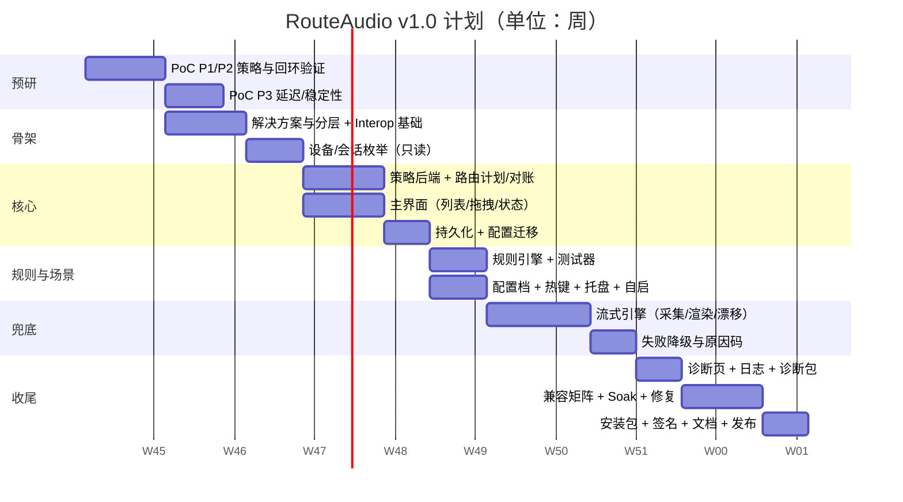

# 03 · 项目结构与实施计划

| 项 | 内容 |
| --- | --- |
| 文档编号 | RA-PLAN-001 |
| 版本 | v1.0 |
| 日期 | 2026-11-08 |
| 关联 | [01 需求](01-需求规格说明书.md) · [02 架构](02-技术方案与架构设计.md) · [04 附录](04-附录-PoC验证清单与技术参考.md) |

---

## 1. 仓库总览

```
RouteAudio/
├─ .github/
│  ├─ workflows/
│  │  ├─ ci.yml                    # PR：构建 + 单测 + 静态分析 + 依赖审计
│  │  ├─ release.yml               # tag：签名 + 打包 + 发布 + SBOM
│  │  └─ nightly.yml               # 每夜：集成测试（自托管音频 VM）+ Soak 冒烟
│  ├─ ISSUE_TEMPLATE/
│  │  ├─ bug_report.yml            # 强制填写：系统版本/音频设备/诊断包
│  │  └─ feature_request.yml
│  └─ PULL_REQUEST_TEMPLATE.md     # 变更说明 + 测试证据 + 风险
├─ docs/
│  ├─ README.md                    # 文档索引
│  ├─ 01-需求规格说明书.md
│  ├─ 02-技术方案与架构设计.md
│  ├─ 03-项目结构与实施计划.md
│  ├─ 04-附录-PoC验证清单与技术参考.md
│  ├─ adr/                         # 架构决策记录（与 02 §13 对应，单文件一条）
│  │  ├─ 001-policy-first.md
│  │  └─ ...
│  ├─ user-guide/                  # 用户手册（截图 + FAQ）
│  └─ images/                      # 线框图、架构图源文件（drawio/png）
├─ src/
│  ├─ Directory.Build.props        # 统一 TFM / LangVersion / 分析器 / 版本号
│  ├─ Directory.Packages.props     # 中央包版本管理（CPM）
│  ├─ RouteAudio.sln
│  ├─ .editorconfig
│  ├─ RouteAudio.App/              # WPF 应用（唯一可执行入口）
│  ├─ RouteAudio.Core/             # 领域与应用服务（纯 .NET）
│  ├─ RouteAudio.Audio/            # Windows 音频平台实现
│  ├─ RouteAudio.Interop/          # P/Invoke 与 COM 定义（唯一允许）
│  ├─ RouteAudio.Contracts/        # UI ↔ Engine IPC 契约（v2 用）
│  ├─ RouteAudio.Engine/           # 独立音频引擎宿主（v2）
│  ├─ RouteAudio.Cli/              # 命令行工具
│  └─ tests/
│     ├─ RouteAudio.Core.Tests/
│     ├─ RouteAudio.Audio.Tests/
│     ├─ RouteAudio.IntegrationTests/
│     ├─ RouteAudio.Benchmarks/
│     └─ RouteAudio.TestKit/       # 假实现、测试数据、音频生成器
├─ installer/
│  ├─ RouteAudio.Installer.wixproj
│  ├─ Package.wxs                  # 组件/快捷方式/注册表/启动项
│  ├─ License.rtf
│  └─ build-msi.ps1
├─ build/
│  ├─ version.json                 # GitVersion / MinVer 配置
│  ├─ build.ps1                    # restore → build → test → publish → package
│  ├─ sign.ps1                     # 签名（本地/CI 共用）
│  └─ publish.ps1                  # 生成 portable zip + MSI + 符号包
├─ tools/
│  ├─ AudioProbe/                  # 内部工具：枚举设备/会话、播放测试音、测量延迟
│  ├─ SessionDump/                 # 导出会话快照（排障用）
│  └─ StressLoopback/              # 压力测试：N 路回环 + 注入设备插拔
├─ samples/
│  ├─ config-minimal.json
│  ├─ config-dual-device.json
│  └─ config-streaming.json
├─ .gitignore
├─ .gitattributes                  # 文本换行、二进制标记
├─ CHANGELOG.md
├─ CODE_OF_CONDUCT.md
├─ CONTRIBUTING.md
├─ LICENSE                         # MIT
├─ THIRD-PARTY-NOTICES.md
├─ SECURITY.md                     # 漏洞报告流程
└─ README.md
```

---

## 2. 解决方案与项目职责

| 项目 | 类型 | TFM | 职责 | 允许的依赖 |
| --- | --- | --- | --- | --- |
| `RouteAudio.App` | WinExe (WPF) | `net8.0-windows10.0.22621.0` | 组合根、UI、托盘、热键、通知、向导 | Core、Audio、Interop、Contracts |
| `RouteAudio.Core` | Library | `net8.0` | 领域模型、路由计划、规则、配置档、状态机、对账、诊断抽象 | 无（仅 BCL + Microsoft.Extensions.*） |
| `RouteAudio.Audio` | Library | `net8.0-windows10.0.22621.0` | WASAPI：设备、会话、策略后端、流式引擎、电平、MMCSS | Core、Interop |
| `RouteAudio.Interop` | Library | `net8.0-windows` | COM 接口声明、CsWin32 生成、HSTRING/PROPVARIANT 帮助类 | 无 |
| `RouteAudio.Contracts` | Library | `net8.0` | IPC 消息 DTO 与接口（v1 进程内实现，v2 管道实现） | 无 |
| `RouteAudio.Engine` | WinExe (v2) | `net8.0-windows` | 独立引擎宿主：加载配置、运行后端、IPC 服务 | Core、Audio、Contracts |
| `RouteAudio.Cli` | Exe | `net8.0-windows` | 命令行；通过 IPC 或直接调用 Core | Core、Contracts |
| `RouteAudio.Core.Tests` | xUnit | `net8.0` | 核心逻辑单测（无需 Windows 音频） | Core、TestKit |
| `RouteAudio.Audio.Tests` | xUnit | `net8.0-windows` | 互操作与纯函数级测试（格式转换、漂移算法、HSTRING） | Audio、Interop |
| `RouteAudio.IntegrationTests` | xUnit | `net8.0-windows` | 真实设备上的端到端（需音频硬件，自托管 VM 跑） | 全部 |
| `RouteAudio.Benchmarks` | BenchmarkDotNet | `net8.0` | 环形缓冲、规则匹配、配置序列化 | Core、Audio |
| `RouteAudio.TestKit` | Library | `net8.0` | `FakeDeviceService`、`FakeBackend`、`ToneGenerator`、临时配置工厂 | Core |

---

## 3. 分层与依赖规则

```
        ┌──────────────┐
        │ RouteAudio.App│
        └──┬────┬────┬──┘
           │    │    └──────────────► Contracts
           │    └────────► Audio ────► Interop
           └────────► Core
                        ▲
        Engine ─────────┘           Cli ──► Core / Contracts
```

**硬性规则（由 `BannedSymbols` 分析器 + CI 脚本双重检查）**

1. `RouteAudio.Core` 中禁止出现：`DllImport`、`LibraryImport`、`System.Windows`、`Microsoft.Win32`、`Process`（进程访问抽象成 `IProcessCatalog`）。
2. `RouteAudio.Interop` 中禁止出现：业务逻辑、字符串格式化文案、日志。
3. 除 `RouteAudio.Interop` 外，任何项目出现 `[DllImport]` / `[LibraryImport]` / `Marshal.` 即 CI 失败。
4. `RouteAudio.Audio` 不得引用 `RouteAudio.App`（禁止反向依赖）。
5. 所有跨线程 UI 更新必须经 `IUiDispatcher`，禁止在音频线程直接 `Dispatcher.Invoke`。

---

## 4. 各项目内部结构

### 4.1 RouteAudio.App

```
RouteAudio.App/
├─ App.xaml / App.xaml.cs            # 组合根：DI 容器、全局异常、单实例、启动流程
├─ AppHost.cs                        # 后台服务启动顺序与生命周期（IHostedService 风格）
├─ Views/
│  ├─ MainWindow.xaml                # 路由台（左应用 / 右设备通道）
│  ├─ SettingsWindow.xaml
│  ├─ DiagnosticsWindow.xaml
│  ├─ ProfileEditorWindow.xaml
│  ├─ OnboardingWindow.xaml
│  └─ Dialogs/ConfirmDialog.xaml
├─ Controls/
│  ├─ AppCard.xaml                   # 应用卡片：图标/名称/电平/状态徽标
│  ├─ DeviceLane.xaml                # 设备通道：标题栏/已路由应用列表/拖放目标
│  ├─ LevelMeter.cs                  # DrawingVisual 实现，20fps
│  ├─ StatusBadge.xaml               # 状态徽标（策略/流式/回退/失败）
│  └─ DragDrop/AppDragBehavior.cs    # 拖拽附加行为（含键盘等价操作）
├─ ViewModels/
│  ├─ MainViewModel.cs
│  ├─ AppCardViewModel.cs
│  ├─ DeviceLaneViewModel.cs
│  ├─ SettingsViewModel.cs
│  ├─ DiagnosticsViewModel.cs
│  └─ OnboardingViewModel.cs
├─ Services/
│  ├─ TrayIconService.cs
│  ├─ HotkeyService.cs
│  ├─ NotificationService.cs
│  ├─ SingleInstanceService.cs
│  ├─ ThemeService.cs
│  └─ UiDispatcher.cs
├─ Converters/
├─ Resources/
│  ├─ Themes/{Light,Dark,HighContrast}.xaml
│  ├─ Styles/Controls.xaml
│  ├─ Icons/*.xaml
│  └─ Strings/{zh-CN,en-US}.resx     # 文案资源化
└─ app.manifest                      # asInvoker、DPI 感知、Win10/11 兼容性声明
```

### 4.2 RouteAudio.Core

```
RouteAudio.Core/
├─ Model/
│  ├─ DeviceEndpoint.cs
│  ├─ AudioFormat.cs
│  ├─ AppIdentity.cs
│  ├─ AppKey.cs                      # 持久化用的稳定键（路径哈希 + 签名）
│  ├─ RouteEntry.cs
│  ├─ RouteTarget.cs
│  ├─ RouteMode.cs                   # auto/policyOnly/streamingOnly/virtualCable
│  ├─ RouteState.cs
│  ├─ ReasonCode.cs
│  ├─ Profile.cs
│  └─ Settings.cs
├─ Rules/
│  ├─ MatchNode.cs                   # 条件树（All/Any/Path/ProcessName/Signer/…）
│  ├─ Rule.cs
│  ├─ RuleAction.cs
│  ├─ RuleSet.cs
│  ├─ RuleEvaluator.cs
│  ├─ RuleExplanation.cs             # 命中解释（供 UI 展示）
│  └─ GlobMatcher.cs                 # 自实现通配符（支持 ** 与大小写不敏感）
├─ Routing/
│  ├─ RoutePlanner.cs                # DesiredState + ActualState → RoutePlan
│  ├─ RoutePlan.cs
│  ├─ RouteDiff.cs
│  ├─ Reconciler.cs                  # 串行执行 + 校验 + 去抖
│  ├─ RouteStateMachine.cs
│  ├─ RouteResolver.cs               # 优先级合并（手动 > 配置档 > 规则 > 默认）
│  └─ DeviceFallbackPolicy.cs
├─ Profiles/ProfileService.cs
├─ Abstractions/
│  ├─ IDeviceService.cs
│  ├─ ISessionService.cs
│  ├─ IProcessCatalog.cs
│  ├─ IRoutingBackend.cs
│  ├─ IStreamHost.cs
│  ├─ IRoutingBackendFactory.cs
│  ├─ IProfileStore.cs
│  ├─ IConfigStore.cs
│  ├─ IClock.cs
│  ├─ IUiDispatcher.cs
│  └─ ILogger.cs                     # 薄封装，避免 Core 依赖具体日志库
├─ Diagnostics/
│  ├─ RouteAuditEntry.cs
│  ├─ DiagnosticSnapshot.cs
│  └─ SelfCheckService.cs
├─ Config/
│  ├─ ConfigDocument.cs              # 与 JSON 一一对应的 DTO
│  ├─ ConfigMapper.cs                # DTO ↔ 领域模型（设备指纹重映射）
│  ├─ ConfigMigrations/IMigration.cs + M1To2.cs + M2To3.cs
│  └─ ConfigValidator.cs
└─ ServiceCollectionExtensions.cs    # AddRouteAudioCore()
```

### 4.3 RouteAudio.Audio

```
RouteAudio.Audio/
├─ Devices/
│  ├─ MmDeviceEnumerator.cs          # IMMDeviceEnumerator 封装（IDisposable）
│  ├─ DeviceService.cs               # IDeviceService 实现
│  ├─ DeviceWatcher.cs               # IMMNotificationClient → Channel<DeviceEvent>
│  ├─ DevicePropertyReader.cs        # 友好名/外形/枚举器/容器 ID
│  ├─ DeviceFingerprint.cs           # 容器 ID + 名称 + 枚举器 → 指纹
│  └─ DefaultDeviceMonitor.cs        # 三角色默认设备跟踪
├─ Sessions/
│  ├─ SessionService.cs              # 全端点会话聚合
│  ├─ SessionWatcher.cs              # 每端点 IAudioSessionManager2 订阅
│  ├─ SessionVolume.cs               # ISimpleAudioVolume / IChannelAudioVolume
│  └─ ProcessIdentityResolver.cs     # 路径/版本信息/签名/父子关系（调用 IProcessCatalog 实现）
├─ Policy/
│  ├─ AudioPolicyConfigFactory.cs    # 内部 WinRT 类封装（IID 探测 + 虚表）
│  ├─ PolicyRoutingBackend.cs        # IRoutingBackend 实现
│  ├─ PolicyFeatureProbe.cs          # 自检：读写回环测试
│  └─ HResultMap.cs                  # HRESULT → ReasonCode
├─ Streaming/
│  ├─ ProcessLoopbackCapture.cs      # ActivateAudioInterfaceAsync + 采集循环
│  ├─ DeviceLoopbackCapture.cs       # 虚拟声卡模式：端点回环
│  ├─ LoopbackRenderStream.cs        # IAudioRenderClient 渲染循环
│  ├─ StreamingBackend.cs            # IRoutingBackend 实现（编排 capture/render）
│  ├─ RingBuffer.cs                  # SPSC 无锁 float 环形缓冲
│  ├─ DriftCorrector.cs              # 水位反馈 + 比率微调
│  ├─ FadeProcessor.cs               # 淡入淡出防爆音
│  ├─ SoftLimiter.cs                 # 增益后限幅
│  ├─ LevelMeter.cs                  # 原子计数 → RMS/Peak
│  └─ MmcssThread.cs                 # AvSetMmThreadCharacteristics 封装
├─ VirtualCable/
│  ├─ VirtualCableDetector.cs        # 识别 VB-CABLE/VoiceMeeter 端点
│  └─ CableRoutingBackend.cs         # 策略指向虚拟端点 + 端点回环采集
├─ Audio/
│  ├─ AudioFormatHelper.cs           # WAVEFORMATEX/EXTENSIBLE 构建与比较
│  ├─ SampleConverter.cs             # float32 ↔ 16/24/32 转换（仅必要处）
│  └─ AudioClientFactory.cs          # 共享/独占初始化、事件驱动
├─ Threading/
│  ├─ AudioThread.cs                 # 命名线程 + MMCSS + 退出协调
│  └─ ChannelPump.cs                 # 事件回调 → 后台串行处理
├─ ServiceCollectionExtensions.cs    # AddRouteAudioPlatform()
└─ Diagnostics/AudioCounters.cs      # underrun/overrun/漂移/延迟统计（原子）
```

### 4.4 RouteAudio.Interop

```
RouteAudio.Interop/
├─ NativeMethods.cs                  # CsWin32 生成（partial class，源生成）
├─ ComInterfaces/
│  ├─ IMMDevice.cs / IMMDeviceEnumerator.cs / IMMNotificationClient.cs
│  ├─ IAudioClient.cs / IAudioRenderClient.cs / IAudioCaptureClient.cs
│  ├─ IAudioSessionManager2.cs / IAudioSessionControl2.cs / IAudioSessionEvents.cs
│  ├─ ISimpleAudioVolume.cs / IChannelAudioVolume.cs
│  ├─ IPropertyStore.cs / IPropertyStoreFactory.cs
│  └─ IActivateAudioInterfaceAsyncOperation.cs / IActivateAudioInterfaceCompletionHandler.cs
├─ WinRT/
│  ├─ RoInterop.cs                   # RoGetActivationFactory / RoInitialize
│  ├─ HString.cs                     # WindowsCreateString/WindowsDeleteString 封装
│  └─ IInspectable.cs                # GetIids
├─ Structs/
│  ├─ PropVariant.cs
│  ├─ WaveFormat.cs                  # WAVEFORMATEX / WAVEFORMATEXTENSIBLE
│  └─ AudioclientActivationParams.cs # PROCESS_LOOPBACK 参数
└─ ComBase.cs                        # ComImport 基类、Marshal 帮助、HRESULT 常量
```

### 4.5 测试与工具

```
tests/RouteAudio.TestKit/
├─ FakeDeviceService.cs / FakeSessionService.cs / FakeBackend.cs
├─ FakeClock.cs
├─ ToneGenerator.cs                  # 生成正弦/扫频/脉冲串 WAV（内存）
└─ TestConfigFactory.cs

tools/AudioProbe/                    # 控制台工具，发布内部版本
├─ Program.cs                        # 子命令：devices / sessions / tone / latency / loopback-test
└─ Commands/*.cs

tools/StressLoopback/                # 多路回环 + 设备插拔 + 内存/句柄曲线
```

---

## 5. 核心接口骨架

```csharp
// Core/Abstractions
public interface IDeviceService
{
    IReadOnlyList<DeviceEndpoint> GetActiveRenderEndpoints();
    DeviceEndpoint? GetDefaultEndpoint(ERole role);
    DeviceEndpoint? FindById(string endpointId);
    IAsyncEnumerable<DeviceEvent> WatchAsync(CancellationToken ct);
    Task<bool> SetDefaultEndpointAsync(string endpointId, ERole role, CancellationToken ct);
}

public interface ISessionService
{
    IReadOnlyList<AudioSessionInfo> GetSessions();          // 全端点聚合
    IReadOnlyList<AudioSessionInfo> GetSessionsForProcess(uint pid);
    IAsyncEnumerable<SessionEvent> WatchAsync(CancellationToken ct);
    Task SetVolumeAsync(uint pid, double scalar, CancellationToken ct);
    Task SetMuteAsync(uint pid, bool mute, CancellationToken ct);
}

public interface IRoutingBackend
{
    string Id { get; }
    BackendCapabilities Capabilities { get; }
    Task<RouteResult> ApplyAsync(RouteRequest request, CancellationToken ct);
    Task<RouteResult> RemoveAsync(AppKey app, CancellationToken ct);
    Task<RouteObservation> ObserveAsync(AppKey app, CancellationToken ct);
}

public interface IStreamHost           // 流式引擎门面（单进程内实现）
{
    Task<StreamHandle> StartAsync(AppKey app, uint pid, string targetEndpointId, StreamOptions options, CancellationToken ct);
    Task StopAsync(StreamHandle handle, CancellationToken ct);
    StreamMetrics GetMetrics(StreamHandle handle);
}

public interface IProfileStore
{
    IReadOnlyList<Profile> Profiles { get; }
    Profile? ActiveProfile { get; }
    Task SwitchAsync(string profileId, CancellationToken ct);
    event EventHandler<ProfileChangedEventArgs>? Changed;
}

public interface IClock { DateTimeOffset UtcNow { get; } long TimestampMs { get; } }
```

```csharp
// Core/Routing — 对账核心
public sealed class RoutePlanner
{
    public RoutePlan Plan(
        IReadOnlyDictionary<AppKey, RouteEntry> desired,
        IReadOnlyDictionary<AppKey, RouteObservation> actual)
    {
        // 1) desired 有、actual 无或有差异 → Add/Update
        // 2) actual 有、desired 无 → Remove
        // 3) 目标设备不存在 → 用 DeviceFallbackPolicy 生成 Degraded 项
        // 4) 输出按 Removing → Updating → Adding 排序的不可变计划
    }
}

public sealed class Reconciler : IAsyncDisposable
{
    // 触发源：启动 / 设备事件 / 会话事件 / 配置变更 / 5s 定时 / 唤醒
    // 串行化：SemaphoreSlim(1)；积压触发合并为一次
    // 每项操作 300ms 后校验；失败 → 原因码 + 重试策略
}
```

**组合根（App/AppHost.cs 节选）**

```csharp
var builder = Host.CreateApplicationBuilder();
builder.Services
    .AddRouteAudioCore()        // 纯领域服务
    .AddRouteAudioPlatform()    // 设备/会话/后端/流式
    .AddSingleton<IUiDispatcher, WpfUiDispatcher>()
    .AddSingleton<MainViewModel>()
    .AddHostedService<AudioReconcilerHostedService>();

var host = builder.Build();
await host.StartAsync();
```

---

## 6. 构建配置

**`src/Directory.Build.props`**

```xml
<Project>
  <PropertyGroup>
    <LangVersion>12</LangVersion>
    <Nullable>enable</Nullable>
    <ImplicitUsings>enable</ImplicitUsings>
    <TreatWarningsAsErrors>true</TreatWarningsAsErrors>
    <EnableNETAnalyzers>true</EnableNETAnalyzers>
    <AnalysisLevel>latest-recommended</AnalysisLevel>
    <InvariantGlobalization>false</InvariantGlobalization>
    <Platforms>x64;arm64</Platforms>
    <RuntimeIdentifiers>win-x64;win-arm64</RuntimeIdentifiers>
    <PublishSingleFile>false</PublishSingleFile>       <!-- 保留 .pdb 便于排障 -->
    <DebugType>portable</DebugType>
    <Version>0.1.0</Version>
    <Authors>RouteAudio Contributors</Authors>
    <PackageLicenseExpression>MIT</PackageLicenseExpression>
  </PropertyGroup>
  <ItemGroup>
    <PackageReference Include="Microsoft.CodeAnalysis.NetAnalyzers" PrivateAssets="all" />
  </ItemGroup>
</Project>
```

**构建命令**

```powershell
pwsh ./build/build.ps1 -Configuration Release -Runtime win-x64
# 内部执行：dotnet restore → build → test → publish → installer/build-msi.ps1
```

**打包形态**

| 形态 | 用途 | 说明 |
| --- | --- | --- |
| 框架依赖版（FDD） | 主分发 | 需 .NET 8 Desktop Runtime；安装包 ≤ 8 MB |
| 自包含版（SCD） | 离线/懒人 | 安装包 ≤ 70 MB；启动稍慢 |
| 便携版 zip | 绿色/测试 | `--portable` 配置落在 exe 旁 |
| MSI | 正式安装 | 每用户安装，写 HKCU 启动项，可选开机自启 |

---

## 7. 测试计划

### 7.1 测试分层

| 层级 | 范围 | 运行环境 | 门禁 |
| --- | --- | --- | --- |
| 单元测试 | Core：规则匹配、优先级、计划/差异、状态机、配置迁移、原因码映射、通配符 | 任意（无音频） | 每次 PR 必过；Core 覆盖率 ≥ 70%，关键类 ≥ 85% |
| 组件测试 | Audio 纯函数：格式构建、漂移算法、环形缓冲、限幅器、HString 生命周期 | 任意 | 每次 PR 必过 |
| 集成测试 | 真实设备：枚举、会话、策略写入/回读、进程回环采集、延迟测量 | 自托管 VM（带虚拟音频设备）+ 物理机 | 每夜 + 发布前 |
| 端到端（E2E） | 启动 App → 拖拽 → 播放测试音 → 验证端点输出 | 物理机（人工/自动化录波） | 里程碑 |
| soak | 72 h 连续，含插拔/睡眠/切用户 | 物理机 | 发布前 |
| 兼容性 | 矩阵见 01 §7.3 | 多台实机/VM | 发布前 |
| 可用性 | 5 名新用户完成任务与时长 | 线下 | v1.0 前 |

### 7.2 关键测试用例（节选）

| ID | 场景 | 步骤 | 期望 |
| --- | --- | --- | --- |
| TC-RTE-001 | 策略路由生效 | 启动游戏（默认耳机）→ 路由到音箱 | 500 ms 内状态 ActivePolicy；声音从音箱出 |
| TC-RTE-002 | 进程未播放 | 先设置路由，再启动应用 | 状态 Pending → 会话创建后 1 s 内 Active |
| TC-RTE-003 | 重复应用 | 连续点击同一路由 10 次 | 幂等；无重复通知；日志无异常 |
| TC-RTE-004 | 端点消失 | 播放中拔出 USB 声卡 | 2 s 内 Degraded + 通知；恢复后自动回原设备 |
| TC-RTE-005 | 独占模式 | 用独占模式播放器占用目标设备 | 显示 RA-004/RA-005；不崩溃；不静音 |
| TC-RTE-006 | DRM 内容 | 播放受保护流媒体并尝试流式路由 | 显示 RA-006；原播放不受影响 |
| TC-VOL-001 | 音量同步 | 在 RouteAudio 调音量 → 系统混音器查看 | 双向一致，误差 ≤ 1% |
| TC-STREAM-001 | 延迟 | 脉冲串经流式路由 | P95 ≤ 50 ms（互相关） |
| TC-STREAM-002 | 漂移 | 连续播放 60 min | 队列水位在目标 ±10 ms；无累积偏移 |
| TC-STREAM-003 | 抗抖动 | 注入 20% CPU 占用与线程抢占 | 无爆音；underrun = 0 |
| TC-CFG-001 | 配置损坏 | 写入非法 JSON 后启动 | 回退 .bak；提示；不丢原文件 |
| TC-CFG-002 | 迁移 | 用 v1 配置启动 v3 | 自动迁移；字段不丢；备份生成 |
| TC-UX-001 | 纯键盘 | 仅用键盘完成路由 | 全流程可完成 |

### 7.3 CI 环境说明（重要）

GitHub 托管的 `windows-2022` runner **没有可用音频端点**，因此：

- 单测/组件测试在托管 runner 上跑（Core 与纯函数）。
- 集成测试需要**自托管 Windows VM**，安装一块虚拟音频设备（如「Microsoft 声音映射器」或 VB-CABLE），并在 `nightly.yml` 中以标签 `[self-hosted, audio]` 选择。
- 涉及真实硬件的用例（HDMI/蓝牙/USB 插拔）只能进人工测试清单。

---

## 8. CI/CD

**`ci.yml`（PR 流水线）**

```yaml
name: ci
on: [pull_request]
jobs:
  build:
    runs-on: windows-2022
    steps:
      - uses: actions/checkout@v4
      - uses: actions/setup-dotnet@v4
        with: { dotnet-version: 8.0.x }
      - run: dotnet restore src/RouteAudio.sln
      - run: dotnet build src/RouteAudio.sln -c Release --no-restore /warnaserror
      - run: dotnet test src/RouteAudio.Core.Tests -c Release --no-build --collect:"XPlat Code Coverage"
      - run: dotnet test src/RouteAudio.Audio.Tests -c Release --no-build
      - name: 依赖审计
        run: dotnet list src/RouteAudio.sln package --vulnerable --include-transitive
      - name: 静态规则检查（禁止跨层 DllImport / 依赖方向）
        run: pwsh ./build/check-layering.ps1
```

**`release.yml`（tag 触发）**

1. 全量测试（含自托管集成测试）。
2. `dotnet publish`（FDD + SCD，x64/arm64）。
3. 签名（`signtool` + 时间戳；开源可用 SignPath）。
4. 打包 MSI + portable zip + 符号包（`.snupkg`/PDB 存档）。
5. 生成 SBOM（`dotnet CycloneDX`）与 `THIRD-PARTY-NOTICES.md`。
6. 发布 GitHub Release，附校验和与升级说明；Velopack 推送更新通道。

**版本策略**：SemVer；`0.x` 阶段允许破坏性变更；`1.0` 后配置 `schemaVersion` 与程序版本解耦（配置升级独立于发布）。

---

## 9. 发布与安装

| 项 | 方案 |
| --- | --- |
| 安装范围 | 每用户（`%LOCALAPPDATA%\Programs\RouteAudio`），无需管理员 |
| 快捷方式 | 开始菜单 + 可选桌面 |
| 开机自启 | 安装时询问；写 HKCU `Run` 或创建「登录时」计划任务（可延迟 10 s） |
| 卸载 | 删除程序与自启项；询问是否保留配置；不残留服务/驱动/COM 注册 |
| 升级 | Velopack 差分；升级前自动备份配置；失败可回滚 |
| 静默安装 | `msiexec /i RouteAudio.msi /qn`（企业部署） |
| 首次运行 | 检测 .NET 运行时（FDD）→ 缺则引导下载；检测音频端点 ≥ 2 |
| 崩溃 | 本地 dump（WER LocalDumps 可选）；下次启动提示「上次异常退出」并给诊断包入口 |

---

## 10. 里程碑与排期

假设 3 人（1 音频/系统、1 桌面/UI、0.5 QA、0.2 产品/设计），10 周发布 v1.0：



| 里程碑 | 周 | 交付物 | 出口标准 |
| --- | --- | --- | --- |
| **M0 立项/预研** | W1–W2 | PoC 报告（P1–P4） | P1、P2 结论明确；P3 延迟达标；技术路线冻结 |
| **M1 骨架** | W2–W3 | 解决方案、分层、设备/会话枚举工具 | 能列出设备与全部会话；日志/配置骨架可用 |
| **M2 路由核心** | W4–W5 | 策略后端、路由计划、对账、主界面拖拽 | UAT-01 雏形通过；状态页可解释 |
| **M3 规则与场景** | W6 | 规则引擎、配置档、热键、迁移 | 规则测试器可用；配置档切换 ≤ 1.5 s |
| **M4 兜底与音量** | W7–W8 | 流式引擎、降级链路、音量/电平 | 流式 P95 ≤ 50 ms；24 h 无爆音 |
| **M5 发布** | W9–W10 | 安装包、签名、文档、诊断包 | 发布门禁全过（01 §10.2） |

**关键路径**：M0 的 P1/P2 验证 → M2 策略后端 → M4 流式引擎。UI 与规则可并行，但不能阻塞关键路径。

---

## 11. 团队与分工

| 角色 | 人数 | 职责 | 关键交付 |
| --- | --- | --- | --- |
| 音频/系统开发 | 1 | Interop、设备/会话、策略后端、流式引擎、性能 | M0 结论、M2 后端、M4 引擎 |
| 桌面/UI 开发 | 1 | WPF、拖拽交互、规则编辑器、托盘/热键、打包 | M2 界面、M3 交互、M5 安装包 |
| QA | 0.5 | 测试设计、兼容矩阵、soak、可用性 | 测试用例集、缺陷报告、发布报告 |
| 产品/设计 | 0.2 | 需求、文案、线框、验收 | SRS、文案、UAT |

**RACI（节选）**

| 事项 | 音频开发 | UI 开发 | QA | 产品 |
| --- | --- | --- | --- | --- |
| 策略 API 封装 | R/A | C | C | I |
| 拖拽交互 | C | R/A | C | C |
| 发布门禁 | C | C | R | A |
| 需求变更 | C | C | C | R/A |

---

## 12. 开发规范

| 项 | 规范 |
| --- | --- |
| 分支 | trunk-based：`main` 常绿；功能分支 `feat/xxx` 短生命周期（≤ 3 天）；发布 tag `v1.0.0` |
| 提交 | Conventional Commits：`feat(routing): …`、`fix(policy): …`、`docs: …` |
| 代码风格 | `.editorconfig`：4 空格、文件级命名空间、`var` 仅在类型显而易见时、私有字段 `_camelCase` |
| 命名 | 类型/方法 PascalCase；异步方法 `Async` 后缀；接口 `I` 前缀；测试 `Method_Scenario_Expected` |
| 评审 | 至少 1 人；音频线程代码需音频开发评审；必须包含「如何验证」 |
| 注释 | 只解释「为什么」；平台黑魔法（策略 API、回环）必须写清版本与来源链接 |
| 异常 | 音频线程禁止抛出；所有 COM 调用检查 HRESULT 并映射原因码；禁止 `catch {}` |
| 资源 | COM 对象必须 `Marshal.ReleaseComObject` 或用 `ComWrappers`/`SafeHandle` 包装；线程必须命名 |
| 依赖 | 新增 NuGet 需在 PR 说明理由、许可证、体积影响；禁止 GPL/AGPL |

**评审检查清单**

- [ ] 是否新增了跨层依赖（Core 引用 Windows / 非 Interop 出现 DllImport）？
- [ ] 音频线程内是否有分配、锁、日志、异常？
- [ ] 新增 HRESULT 是否映射到原因码与用户文案？
- [ ] 是否覆盖「设备消失/进程退出/暂无会话」三种边界？
- [ ] 是否更新了文档/诊断指标/测试用例？

---

## 13. 风险登记册

| ID | 风险 | 概率 | 影响 | 应对 | 触发信号 |
| --- | --- | --- | --- | --- | --- |
| R-01 | 策略 API 被 Windows 更新破坏 | 中 | 高 | 版本探测 + 降级 + 快速小版本；订阅 Insider 通道做前置验证 | 新版本上 `GetIids` 未命中白名单 |
| R-02 | 静音导致进程回环静音（P2 失败） | 中 | 高 | 改走「策略→虚拟声卡→采集」；或只对支持的应用启用流式 | PoC 结果 |
| R-03 | 流式延迟/爆音不达标 | 中 | 中 | 降低缓冲、MMCSS、限制到非实时场景 | 基准测试超标 |
| R-04 | 独占模式 / DRM 应用无法路由 | 高 | 中 | 明确提示 + 引导虚拟声卡；不承诺 100% 覆盖 | 用户报告 |
| R-05 | 杀毒/EDR 误报（ActivateAudioInterfaceAsync + VT_BLOB） | 中 | 中 | 提前送测主流杀软；代码签名；提供白名单说明 | 用户反馈拦截 |
| R-06 | 反作弊将「读进程信息」判为可疑 | 低 | 高 | 只查询受限信息、不注入；在文档声明；必要时对反作弊进程跳过并提示 | 游戏崩溃/封号报告 |
| R-07 | 内部 API 使用违反商店政策 | 中 | 中 | 不走 Microsoft Store；官网分发 | 上架被拒 |
| R-08 | 虚拟声卡许可限制 | 高 | 低 | 不打包；仅检测与引导 | 法务评审 |
| R-09 | 设备 ID 变化导致配置失效 | 高 | 中 | 指纹重映射 + 引导确认 | 用户插拔后路由丢失 |
| R-10 | 开发资源不足导致延期 | 中 | 中 | MVP 范围冻结；规则引擎与 UI 可砍到 P1 | 里程碑滑动 |
| R-11 | 蓝牙设备延迟/断连噪声 | 高 | 低 | 文档说明 + 重连退避 | 测试记录 |
| R-12 | 用户不理解「为什么没生效」而差评 | 中 | 中 | 原因码 + 修复建议 + FAQ + 状态页 | 支持工单 |

---

## 14. 合规与许可

**第三方依赖（计划）**

| 依赖 | 用途 | 许可证 | 注意 |
| --- | --- | --- | --- |
| CommunityToolkit.Mvvm | MVVM 源生成 | MIT | ✅ |
| Microsoft.Extensions.* | DI/Host/Options | MIT | ✅ |
| Serilog / Serilog.Sinks.File | 日志 | Apache-2.0 | ✅ |
| H.NotifyIcon.Wpf | 托盘 | MIT | ✅ |
| Velopack | 更新 | MIT | ✅ |
| Microsoft.Windows.CsWin32 | 互操作生成 | MIT | 仅构建期 |
| xunit / FluentAssertions / BenchmarkDotNet | 测试 | Apache-2.0 / MIT | 仅测试 |
| VB-CABLE（可选，用户自装） | 虚拟声卡 | 专有（捐赠软件） | ❌ 不打包、不再分发、不做商业捆绑；仅检测与提示 |

**合规要点**

1. **不打包第三方音频驱动**；如未来集成虚拟声卡，必须自研或取得书面再分发许可。
2. **不使用内部 API 做规避性功能**（DRM/版权保护），仅做设备选择。
3. 商标：产品名与图标不得暗示与 Microsoft 的官方关系；文档中注明「Windows 是 Microsoft 的注册商标」。
4. 隐私：默认零遥测；如加崩溃上报，需明示内容、可关闭、符合 GDPR/PIPL 的最小化原则。
5. 驱动（v2）：EV 代码签名 + 微软 Attestation 签名；驱动需通过 HLK 相关测试（视分发方式）。
6. 反作弊：不注入、不读写游戏内存、不隐藏进程；文档中明确说明。
7. 出口/加密：使用系统 API，不自行实现加密，无出口管制问题。

---

## 15. 交付物清单（v1.0）

| 类别 | 交付物 |
| --- | --- |
| 代码 | 完整解决方案、单测、集成测试、构建脚本 |
| 安装 | `RouteAudio-1.0.0-x64.msi`、portable zip、符号包、校验和 |
| 文档 | README、用户手册、FAQ、SRS/架构/实施文档、ADR、第三方许可、隐私说明、SBOM |
| 质量 | 测试报告、兼容矩阵结果、Soak 报告、PoC 报告、性能基准报告 |
| 运维 | 诊断包格式说明、日志字段表、发布回滚流程 |
| 社区 | CONTRIBUTING、CODE_OF_CONDUCT、SECURITY、Issue 模板 |
